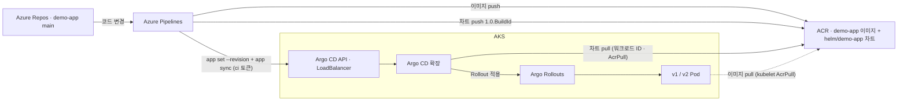

# AKS 워크숍 1단계: Argo CD를 CD 엔진으로 도입하기

빌드는 늘 하던 대로 Azure Pipelines가 하고, 배포는 Argo CD가 맡는다면 무엇이 달라질까요? 이 워크숍에서는 코드 한 줄을 바꾸고 **앱 커밋 → 이미지 digest → 차트 버전 → 실제 Pod 응답**을 따라가며, Argo CD 화면에서 배포·카나리 승격·롤백을 직접 다뤄 봅니다.

> **대상:** Pod와 Service는 알지만 Argo CD는 처음이고, Git 기반 운영(GitOps)에는 아직 익숙하지 않은 팀입니다. 처음이라면 [01. 시작 전 점검](docs/01-prerequisites.md)부터 진행하세요. 로컬 Docker, GitHub 쓰기 권한, 참가자 PC의 `argocd` CLI는 필요하지 않습니다.

## 도입 로드맵: 이번 워크숍은 1단계입니다

| 단계 | 내용 | 배포 결정을 누가·어디에 남기나요? |
|---|---|---|
| **1단계 (이번 워크숍)** | Argo CD를 CD 엔진으로만 도입합니다. ACR에 올린 Helm 차트를 소스로 쓰고, CI가 Argo CD에 Sync를 호출합니다. 팀은 UI와 가시성에 익숙해집니다. | 파이프라인 실행 기록과 Argo CD History |
| 2단계 (다음 단계) | values와 Application 정의를 Git 설정 저장소로 옮깁니다. 이때부터 PR로 배포합니다. | Git 커밋과 PR |
| 3단계 (다음 단계) | 자동 Sync, Self-Heal, ApplicationSet을 적용해 완전한 GitOps로 운영합니다. | Git이 유일한 기준 |

1단계의 메시지는 하나입니다. **배포 결정은 익숙한 파이프라인이 내리고, Argo CD는 실행과 가시성을 맡습니다.** [05](docs/05-canary.md)에서 UI 롤백의 한계를 직접 겪어 보면 왜 2단계가 필요한지 자연스럽게 이어집니다.

> Git 설정 저장소·자동 Sync까지 한 번에 다루던 이전 교재는 [`archive/gitops-canary-v1` 태그](https://github.com/freeman9844/dev-aks-argo-01/tree/archive/gitops-canary-v1)에 그대로 남아 있습니다.

## 실습을 진행하는 방법

각 단계의 **👁️ 설명**에서 무엇이 바뀌는지 읽고, **🟢 실행**은 지정한 위치에서 수행하세요. **📋 확인**은 다음 단계로 넘어가는 조건입니다. **⚠️ 주의**는 비용이 생기거나 보안상 조심할 지점입니다.

| 실행 위치 | 이곳에서 하는 일 |
|---|---|
| 참가자 PC · PowerShell 7 | Azure CLI로 인프라 생성, kubectl로 Pod 관찰 |
| 브라우저 · Argo CD UI | 저장소 연결, Application 생성, 카나리 승격(Resume), 롤백 |
| 브라우저 · Azure DevOps | 저장소·서비스 연결·파이프라인 변수 설정, 코드 변경, 빌드 로그 확인 |
| Microsoft 호스팅 Ubuntu 에이전트 | YAML에 따라 테스트, 이미지·차트 push, Argo CD에 Sync 요청. 참가자가 직접 로그인하지 않습니다. |

## 구성 개요

- 파이프라인은 빌드마다 이미지와 **Helm 차트 `1.0.<빌드 ID>`**를 ACR에 올립니다. 차트의 values에는 방금 만든 이미지의 digest가 고정되어 있습니다.
- 파이프라인은 AKS에 직접 배포하지 않습니다. Argo CD API에 "이 차트 버전으로 Sync 해 주세요"라고 **요청만** 합니다. 이때 쓰는 것은 권한이 좁은 전용 계정 `ci`의 토큰입니다.
- Argo CD는 **자동 Sync를 쓰지 않습니다.** 차트를 ACR에 올리기만 해서는 배포되지 않습니다.
- GitHub는 **교재 배포처**입니다. 실습 때 파이프라인이 읽는 곳은 참가자 자신의 Azure Repos입니다.

⚠️ **공개 노출 주의** — 실습을 쉽게 하려고 Argo CD를 **공인 IP의 LoadBalancer**로 열고 자체 서명 인증서를 그대로 씁니다. 운영에서는 사설 빌드 에이전트, 내부 LoadBalancer나 Ingress, 신뢰된 인증서와 SSO를 사용하세요. 실습이 끝나면 [06](docs/06-cleanup.md)에서 반드시 삭제합니다.

## 모듈 목차

| 모듈 | 실습을 마치면 확인할 수 있는 것 |
|---|---|
| [01. 시작 전 점검](docs/01-prerequisites.md) | 도구·권한·구독·비용 범위 |
| [02. AKS와 Argo CD 확장 설치](docs/02-infrastructure.md) | Ready 노드 2개, Argo CD 확장, Rollouts 컨트롤러, 브라우저로 Argo CD 로그인 |
| [03. Azure Repos와 CI 연결](docs/03-pipeline.md) | ACR의 이미지와 차트, `ci` 토큰이 든 파이프라인, 첫 실행의 정상 경고 |
| [04. Argo CD UI로 첫 배포](docs/04-first-sync.md) | UI에서 만든 Application, CI가 요청한 Sync, v1 Pod 5개 |
| [05. 카나리 승격과 롤백](docs/05-canary.md) | 4:1 정지, UI Resume, UI 롤백(긴급), 되돌림 커밋(영구 복구) |
| [06. 정리](docs/06-cleanup.md) | 실습 과금 종료와 자격 증명 회수 |

**진행 방법:** 명령은 별도 표시가 없으면 워크숍 저장소 루트의 같은 PowerShell 7 세션에서 실행합니다. 예상 결과는 실행할 명령이 아닙니다. 중간에 멈추더라도 [정리](docs/06-cleanup.md)를 진행하세요.

## 실습에서 기록할 값 세 가지

| 값 | 어디서 얻나요? | 어디서 다시 확인하나요? |
|---|---|---|
| 앱 커밋 SHA | `demo-app/main`의 코드 변경 | Pod의 `/version` 응답에 있는 `commit`, 차트의 `appVersion`(앞 7자) |
| 이미지 digest (`sha256:…`) | 파이프라인 `publish` 로그 | Rollout의 `image`, Argo CD **PARAMETERS**의 `image.digest` |
| 차트 버전 (`1.0.<빌드 ID>`) | 파이프라인 `publish` 로그의 `chart:` 줄 | Argo CD **HISTORY AND ROLLBACK**의 Revision, Application의 `status.sync.revision` |

세 값이 한 줄로 이어지면 "지금 떠 있는 Pod가 어느 커밋에서 왔는지"를 언제든 답할 수 있습니다. 05의 롤백은 이 중 **차트 버전**을 이전 값으로 되돌리는 일입니다.

## 세션이 끊겼을 때

02를 처음부터 실행하면 새 그룹이 생깁니다. 대신 기록해 둔 `$rg`, `$aks`, `$acr`, `$loginServer`, `$nodeGroup`, `$argocdServer`, `$env:KUBECONFIG`를 새 PowerShell에서 복원하세요. `az account show --query name -o tsv`와 `kubectl config current-context`가 실습 대상을 가리키는지 확인한 후 마지막으로 통과한 모듈에서 재개합니다. 비밀번호나 토큰은 기록하지 않습니다.

## 검증 기록

**실환경 검증 기록:** Korea Central에서 AKS 노드 2대와 `Microsoft.ArgoCD` 확장(Argo CD v3.5.6)을 배포했습니다. UI에서 만든 Application에 CI가 `ci` 토큰으로 Sync를 요청해 v1 5개가 Ready였습니다. v2 배포 시 v1 4개·v2 1개 상태가 60초 동안 유지됐고, UI Resume 후 v2 5개, UI 롤백 후 카나리 없이 v1 5개(OutOfSync), 되돌림 커밋과 CI 후 Synced·v1 5개를 확인했습니다. `ci` 토큰으로 Application 삭제는 거부(403)됐습니다. 실습 그룹과 AKS 노드 그룹은 삭제했습니다. 참가자의 구독 할당량·조직 정책·권한에 따라 결과가 달라질 수 있습니다.
