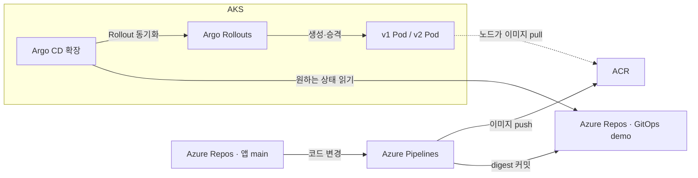

# AKS GitOps 워크숍: Azure Pipelines에서 카나리 롤백까지

이미지 빌드가 성공했는데 왜 AKS에는 아직 이전 버전이 떠 있을까요? 이 워크숍에서는 코드 한 줄을 바꾸고 **앱 커밋 → 이미지 digest → GitOps 커밋 → 실제 Pod 응답**을 따라가며 답을 확인합니다.

> **대상:** Pod와 Service는 알지만 Azure Pipelines와 Argo CD를 처음 연결하는 참가자입니다. 처음이라면 [01. 시작 전 점검](docs/01-prerequisites.md)부터 진행하세요. 로컬 Docker나 GitHub 쓰기 권한은 필요하지 않습니다.

## 실습을 진행하는 방법

각 단계의 **👁️ 설명**에서 무엇이 바뀌는지 읽고, **🟢 실행**은 지정한 위치에서 수행하세요. **📋 확인**은 다음 단계로 넘어가는 조건입니다. **⚠️ 주의**는 비용이 생기거나 되돌리기 어려운 지점입니다.

| 실행 위치 | 이곳에서 하는 일 |
|---|---|
| 참가자 PC · PowerShell 7 | Azure CLI로 인프라 생성, kubectl로 Pod 관찰, Git으로 복구 |
| 브라우저 · Azure DevOps | 저장소·서비스 연결 설정, 빌드 로그와 GitOps 커밋 비교 |
| Microsoft 호스팅 Ubuntu 에이전트 | YAML에 따라 테스트, 이미지 빌드·푸시, GitOps 저장소 갱신. 참가자가 직접 로그인하지 않습니다. |

## 구성 개요: 이미지를 보내는 경로와 배포를 결정하는 경로

GitHub는 **교재 배포처**입니다. 실습 때 Azure Pipelines와 Argo CD가 읽는 곳은 참가자 자신의 **Azure Repos**입니다. CI가 AKS에 직접 배포하지 않으며, ACR에 이미지만 올려도 배포되지 않습니다.

## 모듈 목차

| 모듈 | 실습을 마치면 확인할 수 있는 것 |
|---|---|
| [01. 시작 전 점검](docs/01-prerequisites.md) | 도구·권한·구독·비용 범위 |
| [02. AKS와 Argo CD 확장 설치](docs/02-infrastructure.md) | Ready 노드 2개, Argo CD 확장, Rollouts 컨트롤러 |
| [03. Azure Repos와 CI 연결](docs/03-pipeline.md) | v1 이미지의 ACR digest와 GitOps 커밋 일치 |
| [04. Argo CD로 첫 배포](docs/04-first-sync.md) | GitOps 동기화와 v1 Pod 5개 |
| [05. 카나리 승격과 Git 롤백](docs/05-canary.md) | 두 버전의 HTTP 응답, 4:1 정지, 승격, 복구 |
| [06. 정리](docs/06-cleanup.md) | 실습 과금 종료와 자격 증명 회수 |

**진행 방법:** 명령은 별도 표시가 없으면 워크숍 저장소 루트의 같은 PowerShell 7 세션에서 실행합니다. **브라우저** 단계는 Azure DevOps UI에서 수행합니다. 예상 결과는 실행할 명령이 아닙니다. 중간에 멈추더라도 [정리](docs/06-cleanup.md)를 진행하세요.

## 실습에서 기록할 값 세 가지

| 값 | 어디서 얻나요? | 어디서 다시 확인하나요? |
|---|---|---|
| 앱 커밋 SHA | `demo-app/main`의 v2 변경 | Pod의 `/version` 응답에 있는 `commit` |
| 이미지 digest (`sha256:…`) | 파이프라인 `publish` 로그 | `demo-gitops`의 `dev/kustomization.yaml`과 Rollout의 `image` |
| GitOps 커밋 SHA | `demo-gitops/demo`의 이미지 변경 | Argo CD Application의 `status.sync.revision` |

**두 Git SHA는 서로 달라야 정상입니다.** 하나는 앱을 만든 소스의 이력이고, 다른 하나는 그 이미지를 배포하겠다는 결정의 이력입니다. 이 구분을 해 두면 05에서 앱을 다시 빌드하지 않고 배포만 되돌릴 수 있습니다.

## 세션이 끊겼을 때

02를 처음부터 실행하면 새 그룹이 생깁니다. 대신 기록해 둔 `$rg`, `$aks`, `$acr`, `$loginServer`, `$nodeGroup`, `$env:KUBECONFIG`와 03의 `$repo`를 새 PowerShell에서 복원하세요. `az account show --query name -o tsv`와 `kubectl config current-context`가 실습 대상을 가리키는지 확인한 후 마지막으로 통과한 모듈에서 재개합니다. 비밀번호나 토큰은 기록하지 않습니다.

## 검증 기록

**실환경 검증 기록:** Korea Central에서 AKS 노드 2대와 `Microsoft.ArgoCD` 확장을 배포했습니다. v1 4개·v2 1개 상태가 60초 동안 유지되고 두 버전이 서로 다른 소스 SHA를 반환하는 것을 확인했습니다. 승격 후 v2 5개, Git revert 후 v1 5개가 Ready였습니다. 실습 그룹과 AKS 노드 그룹은 삭제했습니다. 참가자의 구독 할당량·조직 정책·권한에 따라 결과가 달라질 수 있습니다.
