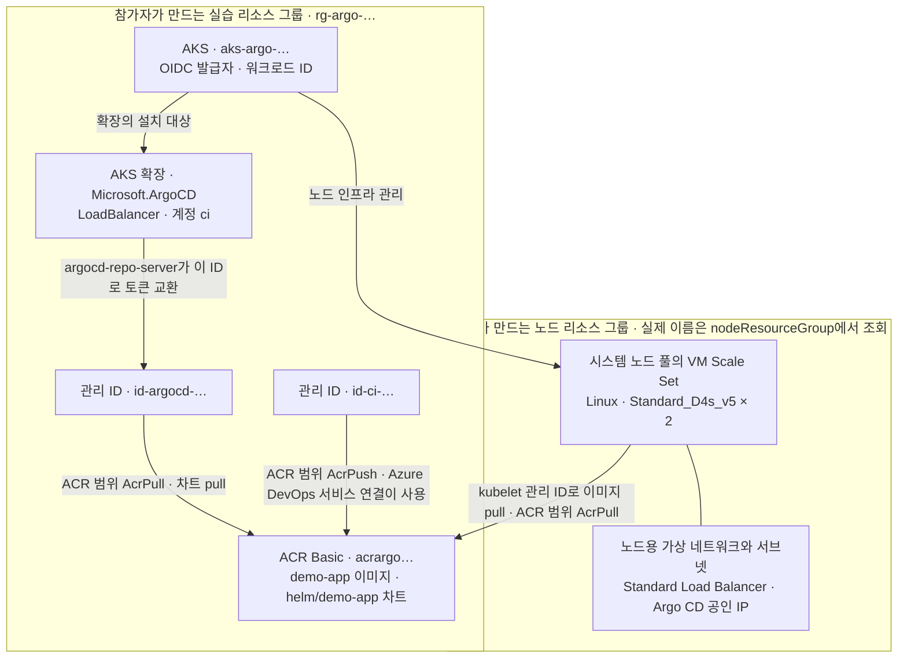
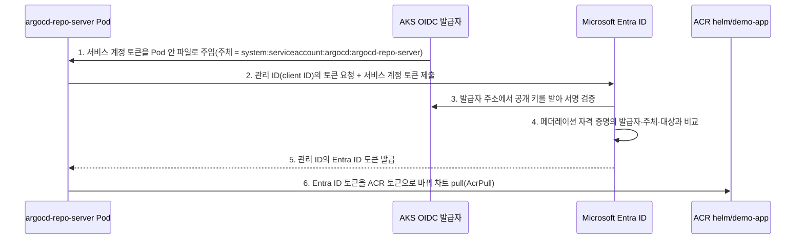

# 02. AKS와 Argo CD 확장 설치

**목표:** [Bicep 템플릿](../infra/main.bicep) 하나로 ACR, AKS, 이미지·차트를 읽을 권한, `Microsoft.ArgoCD` 확장을 설치합니다. 이어서 Argo CD가 비밀번호 없이 ACR에 접속하도록 **워크로드 ID 페더레이션**을 CLI로 직접 연결하고, 브라우저로 Argo CD에 로그인합니다. Helm은 **Argo Rollouts** 설치에만 사용합니다.

## 0. 배포 전에 구조 읽기: Azure에는 두 그룹, Kubernetes에는 세 네임스페이스

👁️ **설명** — 이번 단계는 앱을 배포하는 단계가 아닙니다. **이미지와 차트를 저장할 곳(ACR)**과 **그것을 실행할 곳(AKS)**을 준비합니다. 참가자가 만드는 것은 실습 리소스 그룹 하나지만, AKS를 생성하면 Azure가 **노드 리소스 그룹**을 하나 더 만듭니다. 그래서 실습 그룹에서 노드 VM이 보이지 않아도 정상입니다.



**그림 읽는 법:** 위 상자는 Azure Portal에서 보는 **리소스 그룹**입니다. Kubernetes 네임스페이스는 별도 Azure 그룹이나 별도 VM이 아닙니다. 같은 두 노드 위에서 실행되는 구성 요소를 역할별로 나눈 이름 공간입니다.

| 클러스터 안의 위치 | 무엇이 들어가나요? | 언제 만들어지나요? |
|---|---|---|
| `argocd` | ACR의 차트를 읽어 Kubernetes API에 반영하는 Argo CD | 1절: Bicep이 AKS 확장을 설치할 때 |
| `argo-rollouts` | `Rollout`의 카나리 단계와 승격을 처리하는 컨트롤러 | 2절: Helm 설치 시 |
| `demo` | 실습 앱의 Rollout, ReplicaSet, Pod, Service | 2절에서는 **빈 네임스페이스만** 생성. 앱은 [04. 첫 배포](04-first-sync.md)에서 생성 |

**ACR을 읽고 쓰는 ID는 셋입니다.** 이름이 비슷해 헷갈리기 쉬우니 표로 구분해 두세요.

| ID | 권한 | 하는 일 | 만드는 곳 |
|---|---|---|---|
| kubelet 관리 ID | ACR 범위 `AcrPull` | 노드가 **이미지**를 pull | Bicep(AKS가 자동 생성, 역할만 Bicep) |
| `id-argocd-<AKS 이름>` | ACR 범위 `AcrPull` | `argocd-repo-server`가 **Helm 차트**를 pull | Bicep(관리 ID, 역할). 페더레이션은 3절에서 참가자가 CLI로 추가 |
| `id-ci-<AKS 이름>` | ACR 범위 `AcrPush` | 파이프라인이 이미지와 차트를 push | Bicep(관리 ID, 역할). 페더레이션은 [03](03-pipeline.md)에서 서비스 연결을 만들 때 Azure DevOps가 추가 |

Argo CD의 관리 ID에는 비밀 값이 없습니다. AKS가 `argocd-repo-server` 서비스 계정에 발급한 토큰을 Microsoft Entra ID가 **페더레이션 자격 증명**(발급자 = 이 클러스터, 주체 = `system:serviceaccount:argocd:argocd-repo-server`)으로 확인하고, 그 대가로 관리 ID 토큰을 줍니다. 그래서 다른 클러스터나 다른 Pod는 이 ID를 쓸 수 없습니다. 이 신뢰 관계가 어떻게 생기는지 보이도록 Bicep에서 빼고 [3절](#3-argo-cd에-워크로드-id-페더레이션-연결)에서 직접 만듭니다.

**Argo CD 확장 설정도 Bicep에 있습니다.** 서버를 LoadBalancer로 열고, UI 로그인 없이 API 토큰만 쓰는 CI 전용 계정 `ci`와 그 권한(`demo/demo-app`의 조회·차트 버전 변경·Sync)을 선언합니다. 확장이 관리하는 ConfigMap이나 Service를 `kubectl`로 직접 고치면 확장이 원래대로 되돌릴 수 있으므로, 설정은 항상 템플릿으로 바꿉니다.

## 1. 새 그룹에 인프라 배포

👁️ **설명** — `$lab`을 한 번만 생성해 이름을 맞춥니다. `what-if`에서 확인할 것은 템플릿이 직접 선언하는 리소스입니다. 노드 VM Scale Set 등은 AKS가 내부적으로 만들므로 목록에 따로 나오지 않습니다.

🟢 **실행 · 참가자 PC / PowerShell 7**

```powershell
$lab = (New-Guid).ToString('N').Substring(0,8)
$rg = "rg-argo-$lab"; $aks = "aks-argo-$lab"; $acr = "acrargo$lab"
$region = 'koreacentral'
if ((az group exists -n $rg) -ne 'false') { throw '새 실습 그룹을 사용하세요.' }
az group create -n $rg -l $region --tags workshop=aks-argo-canary
$params = @("aksName=$aks","acrName=$acr")
az deployment group what-if -g $rg -f .\infra\main.bicep -p @params
```

📋 **확인** — 미리 보기에 AKS, ACR, `Microsoft.ArgoCD` 확장, 관리 ID `id-argocd-<AKS 이름>`, 관리 ID `id-ci-<AKS 이름>`, AcrPull 역할 할당 2개, AcrPush 역할 할당 1개가 신규(`+ Create`)로 표시되어야 합니다. 페더레이션 자격 증명은 목록에 없는 것이 정상입니다.

⚠️ **주의** — 아래 `create`부터 노드와 디스크 비용이 발생합니다. 기존 자원 수정·삭제가 보이면 중단하세요. 확장 설치는 AKS 생성 뒤 몇 분 더 걸리므로 전체 배포는 10~15분 정도입니다.

🟢 **실행 · 같은 PowerShell**

```powershell
az deployment group create -g $rg -n demo-infra -f .\infra\main.bicep -p @params
$loginServer = az acr show -g $rg -n $acr --query loginServer -o tsv
$nodeGroup = az aks show -g $rg -n $aks --query nodeResourceGroup -o tsv
az k8s-extension show -g $rg --cluster-name $aks --cluster-type managedClusters -n argocd --query provisioningState -o tsv
```

📋 **확인 · 그림과 내 구독 비교** — 확장 상태가 `Succeeded`이면 아래 읽기 전용 명령으로 두 그룹을 비교하세요.

```powershell
az resource list -g $rg --query "[].{Name:name,Type:type}" -o table
az resource list -g $nodeGroup --query "[].{Name:name,Type:type}" -o table
```

첫 목록에서는 `managedClusters`, `registries`, `userAssignedIdentities` 2개를, 두 번째에서는 `virtualMachineScaleSets`와 네트워크 리소스를 찾습니다. **노드 2대는 VM Scale Set 두 개가 아니라 하나의 집합에 속한 인스턴스 두 개**입니다. 노드 그룹 리소스를 직접 수정하거나 개별 삭제하지 않습니다.

## 2. 클러스터 연결과 Rollouts 설치

👁️ **설명** — `argocd` 네임스페이스에는 차트를 읽어 배포 명세를 반영하는 구성 요소가 있습니다. 하지만 확장을 설치했다고 해서 카나리가 바로 동작하지는 않습니다. 별도 Rollouts 컨트롤러가 `Rollout` 리소스를 보고 새 버전 Pod를 몇 개 띄울지 결정합니다.

🟢 **실행 · 같은 PowerShell**

```powershell
$env:KUBECONFIG = Join-Path ([IO.Path]::GetTempPath()) "$aks.yaml"
az aks get-credentials -g $rg -n $aks --file $env:KUBECONFIG
kubectl get nodes
kubectl get pods -n argocd
helm upgrade --install argo-rollouts argo-rollouts --repo https://argoproj.github.io/argo-helm --version 2.43.12 -n argo-rollouts --create-namespace --wait
kubectl create namespace demo
kubectl get crd rollouts.argoproj.io
```

📋 **확인** — 노드 2개는 `Ready`, `argocd` Pod는 모두 `Running`, 마지막 출력에는 `rollouts.argoproj.io`가 보여야 합니다.

## 3. Argo CD에 워크로드 ID 페더레이션 연결

👁️ **설명** — Argo CD가 ACR에서 차트를 읽으려면 세 가지가 모두 필요합니다.

| 구성 요소 | 하는 일 | 만든 곳 |
|---|---|---|
| ① 관리 ID `id-argocd-<AKS 이름>`과 ACR `AcrPull` | "누가 무엇을 읽을 수 있는가" | 1절 Bicep |
| ② `argocd-repo-server` 서비스 계정의 client ID 어노테이션 | "이 Pod는 어떤 관리 ID를 쓰려 하는가" | 1절 Bicep(확장 설정) |
| ③ 관리 ID의 페더레이션 자격 증명 | "Entra ID가 이 클러스터의 이 서비스 계정 토큰을 믿는가" | **이 절, CLI** |

①과 ②만 있으면 repo-server는 관리 ID를 **쓰려고는 하지만** Entra ID가 토큰 교환을 거절합니다. ③은 "발급자(이 클러스터의 OIDC 주소) + 주체(`system:serviceaccount:argocd:argocd-repo-server`)가 일치하는 토큰만 받아 준다"는 신뢰 관계입니다. 비밀번호나 키를 저장하지 않으므로 교체할 값도 없습니다.

**왜 비밀번호 대신 페더레이션인가요?** ACR 사용자 이름과 비밀번호를 Argo CD 저장소 설정에 넣어도 차트는 읽힙니다. 하지만 그 값은 Kubernetes Secret에 남고, 유출되면 어디서든 쓸 수 있으며, 만료 전에 사람이 교체해야 합니다. 페더레이션을 쓰면 클러스터 밖으로 나가는 장기 비밀 값이 없습니다. Pod가 받는 토큰은 약 1시간 뒤 만료되고, **이 클러스터의 이 서비스 계정**이 아니면 교환되지 않습니다.

**토큰 교환은 이렇게 일어납니다.** 04에서 저장소를 연결하거나 Sync할 때마다 아래 순서가 반복됩니다.



그림의 4단계에서 비교할 기준이 바로 이 절에서 만드는 ③입니다. ③이 없으면 4단계에서 멈추고 `AADSTS70025` 오류가 납니다.

**②는 Pod 안에서 무엇을 하나요?** 서비스 계정에 client ID 어노테이션이 있으면 AKS의 워크로드 ID 웹후크가 repo-server Pod를 만들 때 환경 변수 `AZURE_CLIENT_ID`, `AZURE_TENANT_ID`, `AZURE_FEDERATED_TOKEN_FILE`과 토큰 파일 볼륨을 넣어 줍니다. Argo CD는 이 값을 읽어 그림의 2단계를 수행합니다. 1절에서 확장을 설치할 때 이미 주입이 끝났으므로, 지금 ③을 추가해도 Pod를 다시 만들 필요가 없습니다.

**노드(kubelet) ID를 쓰면 안 되나요?** kubelet ID는 노드가 **이미지**를 pull할 때만 쓰입니다. repo-server는 Pod 안에서 Helm 차트를 직접 내려받으므로 kubelet ID를 사용하지 않습니다. Argo CD가 ACR 차트에 지원하는 인증도 사용자 이름·비밀번호와 워크로드 ID 두 가지뿐입니다.

🟢 **실행 · 같은 PowerShell** — 먼저 ②가 ①과 같은 ID를 가리키는지 봅니다. 두 값이 같아야 합니다.

```powershell
az deployment group show -g $rg -n demo-infra --query properties.outputs.argocdIdentityClientId.value -o tsv
kubectl get sa argocd-repo-server -n argocd -o jsonpath='{.metadata.annotations.azure\.workload\.identity/client-id}{"\n"}'
```

이어서 페더레이션에 넣을 두 값(클러스터의 OIDC 발급자 주소, 관리 ID 이름)을 읽고, 아직 페더레이션이 없는지 확인합니다.

```powershell
$issuer = az aks show -g $rg -n $aks --query oidcIssuerProfile.issuerUrl -o tsv
$argocdId = az deployment group show -g $rg -n demo-infra --query properties.outputs.argocdIdentityName.value -o tsv
$issuer; $argocdId
az identity federated-credential list -g $rg --identity-name $argocdId -o table
```

📋 **확인** — `$issuer`는 `https://koreacentral.oic.prod-aks.azure.com/...`처럼 끝이 `/`인 주소이고, 마지막 목록은 **비어 있어야** 합니다.

👁️ **설명 · 명령의 각 값** — 아래 `create` 명령은 그림의 4단계에서 비교할 값을 등록합니다.

| 인자 | 값 | 의미 |
|---|---|---|
| `--identity-name` | `$argocdId` | 신뢰 관계를 붙일 관리 ID(①) |
| `-n` | `argocd-repo-server` | 자격 증명 이름. 관리 ID 안에서만 구분용이며 아무 이름이나 됩니다 |
| `--issuer` | `$issuer` | 토큰을 발급한 곳. **이 클러스터**의 OIDC 주소이므로 다른 클러스터 토큰은 거절됩니다 |
| `--subject` | `system:serviceaccount:argocd:argocd-repo-server` | 토큰의 주인. `argocd` 네임스페이스의 `argocd-repo-server` 서비스 계정만 허용합니다 |
| `--audiences` | `api://AzureADTokenExchange` | 토큰의 용도. 워크로드 ID 토큰 교환에 쓰는 고정값입니다 |

🟢 **실행 · 같은 PowerShell** — 페더레이션 자격 증명을 만듭니다.

```powershell
az identity federated-credential create -g $rg --identity-name $argocdId -n argocd-repo-server --issuer $issuer --subject system:serviceaccount:argocd:argocd-repo-server --audiences api://AzureADTokenExchange
az identity federated-credential list -g $rg --identity-name $argocdId --query "[].{name:name,subject:subject,issuer:issuer}" -o table
```

📋 **확인** — 목록에 `argocd-repo-server` 한 줄이 보이고 `subject`가 `system:serviceaccount:argocd:argocd-repo-server`여야 합니다. 같은 내용은 Azure Portal의 관리 ID → **Settings → Federated credentials**에서도 볼 수 있습니다.

⚠️ **주의** — 주체 문자열은 `system:serviceaccount:<네임스페이스>:<서비스 계정>` 형식이며 한 글자라도 다르면 교환이 거절됩니다. 새 자격 증명이 반영되기까지 보통 수 초, 길게는 1분 정도 걸립니다. repo-server를 재시작할 필요는 없습니다. 토큰 교환은 차트를 읽을 때마다 새로 일어나기 때문입니다.

💡 **이 절을 건너뛰면?** — 04에서 저장소를 연결할 때 `AADSTS70025: The client '...'(id-argocd-...) has no configured federated identity credentials` 오류로 실패합니다. ①과 ②는 갖춰졌지만 ③이 없어 Entra ID가 토큰 교환을 거절했다는 뜻입니다. 이때 3절 명령만 실행하면 Pod 재시작 없이 바로 연결됩니다.

## 4. 브라우저로 Argo CD 접속

👁️ **설명** — Argo CD 서버는 LoadBalancer Service로 공인 IP를 받습니다. 이 주소는 참가자 브라우저와 03의 파이프라인이 함께 씁니다. 인증서는 Argo CD가 만든 자체 서명 인증서라서 브라우저 경고가 뜨는 것이 정상입니다.

🟢 **실행 · 같은 PowerShell**

```powershell
$argocdServer = kubectl get svc argocd-server -n argocd -o jsonpath='{.status.loadBalancer.ingress[0].ip}'
if (!$argocdServer) { throw '공인 IP가 아직 없습니다. 1분 뒤 다시 실행하세요.' }
"https://$argocdServer"
```

초기 관리자 비밀번호는 화면에 출력하지 않고 클립보드로 복사합니다. 사용자 이름은 `admin`입니다.

```powershell
$encoded = kubectl get secret argocd-initial-admin-secret -n argocd -o jsonpath='{.data.password}'
if ($LASTEXITCODE -ne 0 -or !$encoded) { throw '초기 관리자 Secret을 사용할 수 없습니다.' }
Set-Clipboard -Value ([Text.Encoding]::UTF8.GetString([Convert]::FromBase64String($encoded)))
Remove-Variable encoded
```

🟢 **실행 · 브라우저** — 위에서 출력한 `https://<IP>`를 엽니다. 인증서 경고에서 주소가 **방금 조회한 IP**인지 확인한 뒤 계속 진행합니다. `admin`과 붙여넣은 비밀번호로 로그인하고, 로그인 **뒤에** PowerShell에서 `Set-Clipboard -Value ''`를 실행해 클립보드를 비웁니다.

📋 **확인** — **Applications**에 아직 앱이 없다는 안내가 보입니다. 왼쪽 **Settings → Accounts**에는 `admin`과 `ci`가 보여야 합니다. `ci`는 UI 로그인은 못 하고 API 토큰만 쓰는 계정입니다. 토큰은 03에서 만듭니다.

⚠️ **주의** — 이 화면은 인터넷에 열려 있습니다. 공유 화면이나 녹화 중에는 비밀번호를 보여 주지 말고, 실습 내내 이 클러스터 밖에서 재사용하는 비밀번호를 쓰지 마세요. `$rg`, `$aks`, `$acr`, `$loginServer`, `$nodeGroup`, `$argocdServer`와 `$env:KUBECONFIG`의 **파일 경로**를 기록해 두세요. kubeconfig 파일 내용은 공유하지 않습니다.

**트러블슈팅**

| 증상 | 먼저 볼 것 |
|---|---|
| 노드는 Ready인데 `argocd` Pod가 없음 | 별도 Helm 설치를 하지 마세요. 확장 `provisioningState`와 `kubectl get events -n argocd --sort-by=.lastTimestamp`를 확인합니다. |
| `argocd-server`의 공인 IP가 계속 비어 있음 | `kubectl describe svc argocd-server -n argocd`의 이벤트. 조직 정책이 공인 IP를 막으면 관리자에게 문의합니다. |
| 브라우저가 IP에 접속하지 못함 | 회사 네트워크의 443 아웃바운드 정책, IP를 다시 조회했는지 확인합니다. |
| 3절의 두 client ID가 다름 | 템플릿을 다시 배포하고 `kubectl rollout status deployment/argocd-repo-server -n argocd`로 재시작을 기다립니다. |
| `federated-credential create`가 `$argocdId`를 찾지 못함 | `$argocdId`가 비어 있지 않은지 봅니다. 비어 있으면 1절 배포 이름이 `demo-infra`인지 확인합니다. |

📋 **완료 체크**

- [ ] 노드 2개가 Ready이고 Rollout CRD가 보입니다.
- [ ] 관리 ID `id-argocd-<AKS 이름>`에 페더레이션 자격 증명 `argocd-repo-server`가 1개 있습니다.
- [ ] 브라우저에서 `admin`으로 로그인했고 **Settings → Accounts**에 `ci`가 있습니다.

[← 이전](01-prerequisites.md) · [목차](../README.md) · [다음: CI →](03-pipeline.md)
