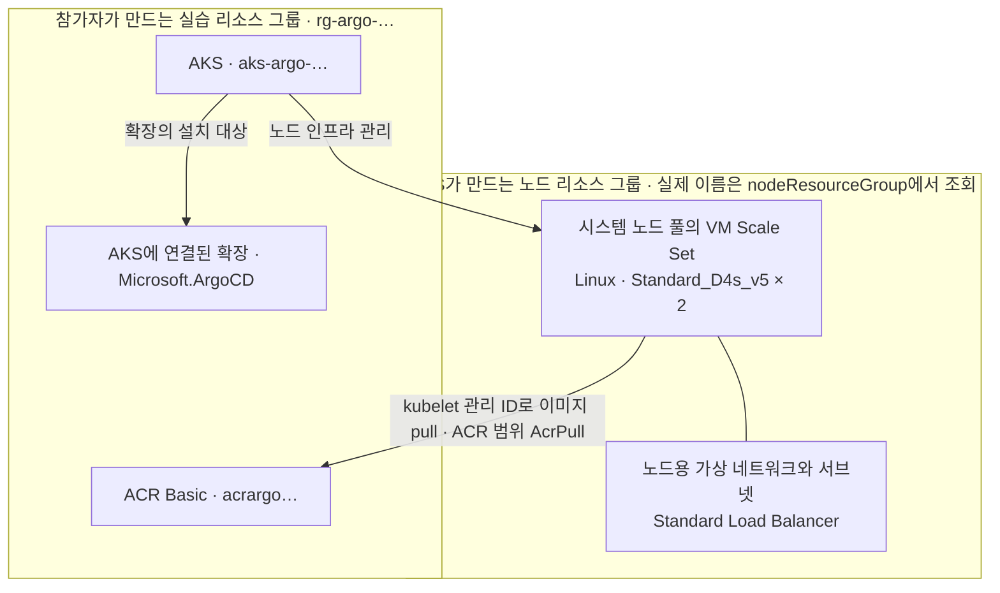

# 02. AKS와 Argo CD 확장 설치

**목표:** [Bicep 템플릿](../infra/main.bicep) 하나로 ACR, AKS, kubelet의 AcrPull 및 `Microsoft.ArgoCD` 확장을 설치합니다. Helm은 **Argo Rollouts**에만 사용합니다.

## 0. 배포 전에 구조 읽기: Azure에는 두 그룹, Kubernetes에는 세 네임스페이스

👁️ **설명** — 이번 단계는 앱을 배포하는 것이 아니라 **이미지를 저장할 곳(ACR)**과 **그 이미지를 실행할 곳(AKS)**을 준비하는 단계입니다. 참가자가 만드는 것은 실습 리소스 그룹 하나지만, AKS를 생성하면 Azure가 **노드 리소스 그룹**을 하나 더 만듭니다. 그래서 실습 그룹에서 노드 VM이 보이지 않아도 정상입니다.



**그림 읽는 법:** 위 상자는 Azure Portal에서 보는 **리소스 그룹**입니다. Kubernetes 네임스페이스는 별도 Azure 그룹이나 별도 VM이 아닙니다. 같은 두 노드 위에서 실행되는 구성 요소를 역할별로 나누는 이름 공간입니다.

| 클러스터 안의 위치 | 무엇이 들어가나요? | 언제 만들어지나요? |
|---|---|---|
| `argocd` | Git의 배포 명세를 읽고 Kubernetes API에 반영하는 Argo CD | 1단계: Bicep이 AKS 확장을 설치할 때 |
| `argo-rollouts` | `Rollout`의 카나리 단계와 승격을 처리하는 컨트롤러 | 2단계: Helm 설치 시 |
| `demo` | 실습 앱의 Rollout, ReplicaSet, Pod, Service | 2단계에서는 **빈 네임스페이스만** 생성. 앱은 [04. 첫 배포](04-first-sync.md)에서 생성 |

**네트워크와 권한은 다릅니다.** Azure CNI Overlay에서는 노드가 Azure 서브넷에 연결되고 Pod IP는 별도 주소 범위를 사용합니다. Standard Load Balancer를 사용하지만 Argo CD 서버의 Service는 `ClusterIP`이므로 이 템플릿이 관리 화면을 인터넷에 공개하지는 않습니다. 한편 `AcrPull`은 **노드가 ACR에서 이미지를 읽는 권한**이지, Argo CD가 Git을 읽거나 CI가 이미지를 푸시할 권한이 아닙니다. CI의 `AcrPush`는 [03](03-pipeline.md), Git 읽기 권한은 [04](04-first-sync.md)에서 따로 연결합니다.

## 1. 새 그룹에 인프라 배포

👁️ **설명** — `$lab`을 한 번만 생성해 이름을 맞춥니다. `what-if`에서 확인할 것은 템플릿이 직접 선언하는 **AKS, ACR, AKS 범위의 확장, ACR 범위의 역할 할당**입니다. 노드 VM Scale Set 등은 AKS가 내부적으로 생성하므로 이 네 항목과 일대일로 표시되지 않습니다.

🟢 **실행 · 참가자 PC / PowerShell 7**

```powershell
$lab = (New-Guid).ToString('N').Substring(0,8)
$rg = "rg-argo-$lab"; $aks = "aks-argo-$lab"; $acr = "acrargo$lab"
$region = 'koreacentral'
if ((az group exists -n $rg) -ne 'false') { throw '새 실습 그룹을 사용하세요.' }
az group create -n $rg -l $region --tags workshop=aks-argo-canary
$params = @("aksName=$aks","acrName=$acr")
az deployment group what-if -g $rg -f .\infra\main.bicep -p @params
```

📋 **확인** — 미리 보기에 AKS, ACR, `Microsoft.ArgoCD` 확장, AcrPull 역할 할당이 신규로 표시되어야 합니다.

⚠️ **주의** — 아래 `create`부터 노드와 디스크 비용이 발생합니다. 기존 자원 수정·삭제가 보이면 중단하세요.

🟢 **실행 · 같은 PowerShell**

```powershell
az deployment group create -g $rg -n demo-infra -f .\infra\main.bicep -p @params
$loginServer = az acr show -g $rg -n $acr --query loginServer -o tsv
$nodeGroup = az aks show -g $rg -n $aks --query nodeResourceGroup -o tsv
az k8s-extension show -g $rg --cluster-name $aks --cluster-type managedClusters -n argocd --query provisioningState -o tsv
```

📋 **확인 · 그림과 내 구독 비교** — 확장 상태가 `Succeeded`이면 아래 읽기 전용 명령으로 두 그룹을 비교하세요.

```powershell
az resource list -g $rg --query "[].{Name:name,Type:type}" -o table
az resource list -g $nodeGroup --query "[].{Name:name,Type:type}" -o table
```

첫 목록에서는 `Microsoft.ContainerService/managedClusters`와 `Microsoft.ContainerRegistry/registries`를, 두 번째에서는 `Microsoft.Compute/virtualMachineScaleSets`와 네트워크 리소스를 찾습니다. **노드 2대는 VM Scale Set 두 개가 아니라 하나의 집합에 속한 인스턴스 두 개**입니다. 다음 단계의 `kubectl get nodes`에서 두 행을 확인하세요. 노드 그룹 리소스를 직접 수정하거나 개별 삭제하지 않습니다.

## 2. 두 컨트롤러 구분하기

👁️ **설명** — `argocd` 네임스페이스에는 Git을 읽어 배포 명세를 반영하는 구성 요소가 있습니다. 하지만 확장을 설치했다고 해서 카나리도 바로 실행되는 것은 아닙니다. 별도 Rollouts 컨트롤러가 `Rollout` 리소스를 보고 새 버전 Pod를 몇 개 띄울지 결정합니다.

🟢 **실행 · 같은 PowerShell**

```powershell
$env:KUBECONFIG = Join-Path ([IO.Path]::GetTempPath()) "$aks.yaml"
az aks get-credentials -g $rg -n $aks --file $env:KUBECONFIG
kubectl get nodes
kubectl get pods -n argocd
helm upgrade --install argo-rollouts argo-rollouts --repo https://argoproj.github.io/argo-helm --version 2.43.12 -n argo-rollouts --create-namespace --wait
kubectl create namespace demo
kubectl get crd rollouts.argoproj.io
```

📋 **확인** — 확장은 `Succeeded`, 노드 2개는 `Ready`, 마지막 출력에는 `rollouts.argoproj.io`가 보여야 합니다. `$rg`, `$aks`, `$acr`, `$loginServer`, `$nodeGroup`과 `$env:KUBECONFIG`의 **파일 경로**를 기록해 두세요. kubeconfig 파일 내용은 공유하지 않습니다.

**트러블슈팅:** 노드는 Ready인데 `argocd` Pod가 아직 없다면 별도 Helm 설치를 하지 마세요. 확장 프로비저닝 상태와 `kubectl get events -n argocd --sort-by=.lastTimestamp`를 먼저 확인합니다.

**완료 체크:** Argo CD Pod와 Rollout CRD가 모두 보입니다.

[← 이전](01-prerequisites.md) · [목차](../README.md) · [다음: CI →](03-pipeline.md)
