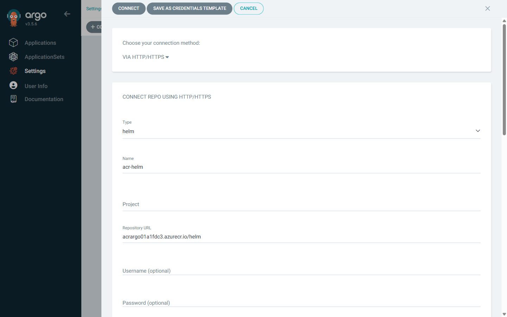
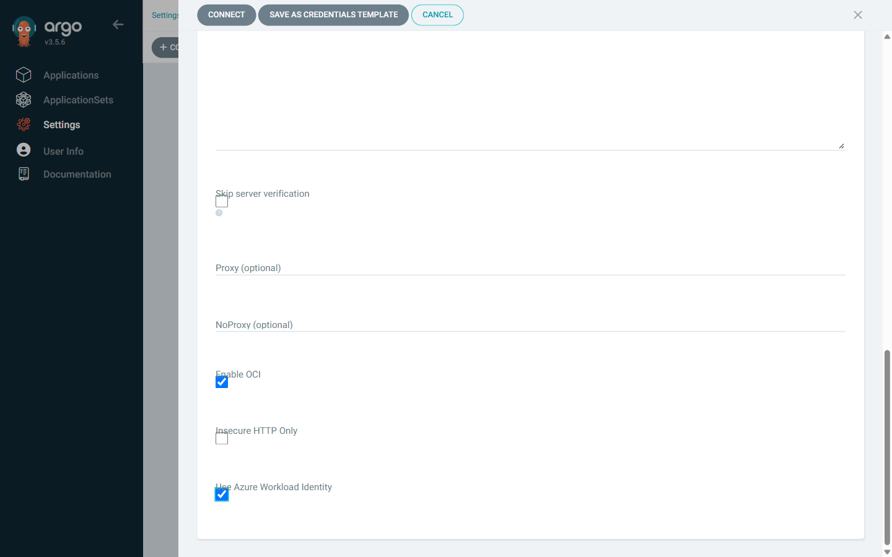
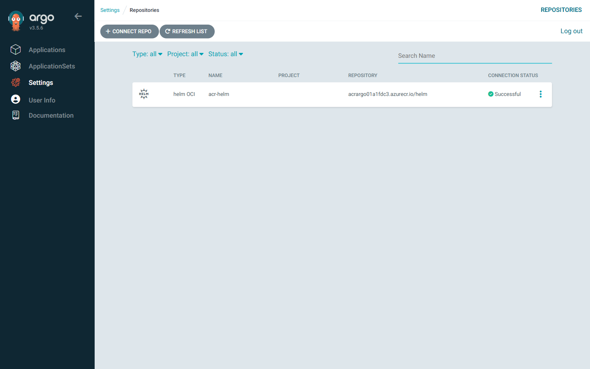
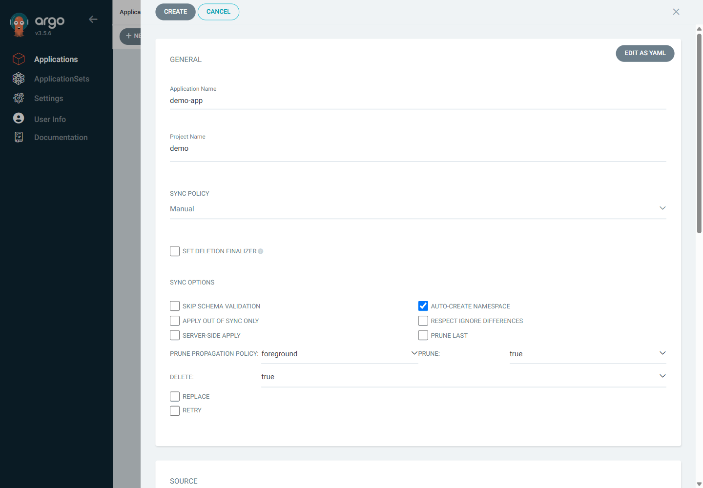
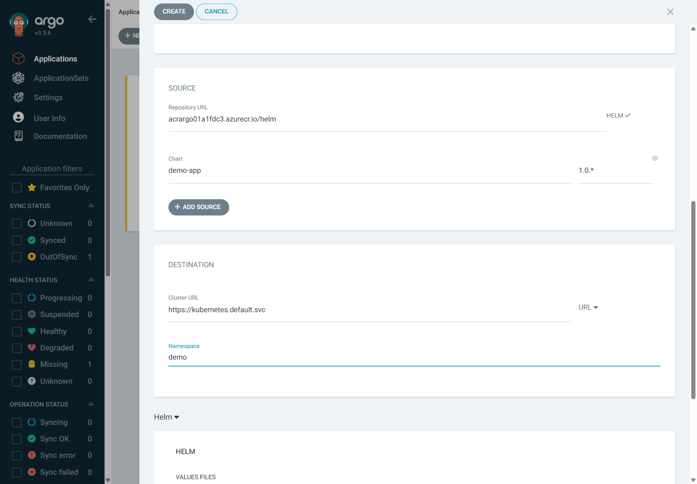
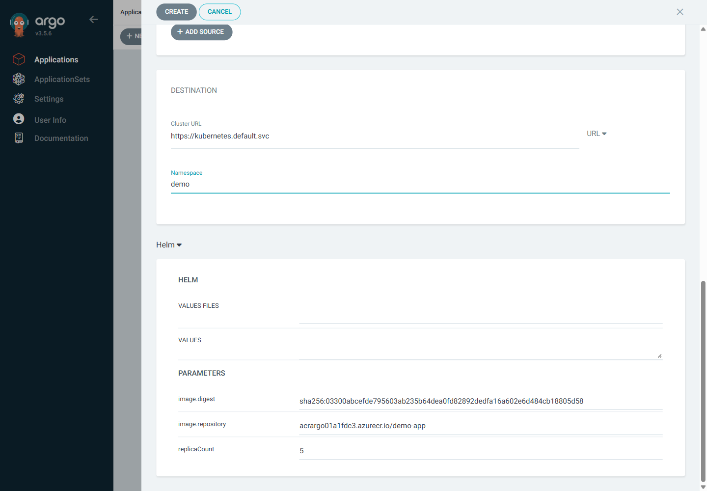
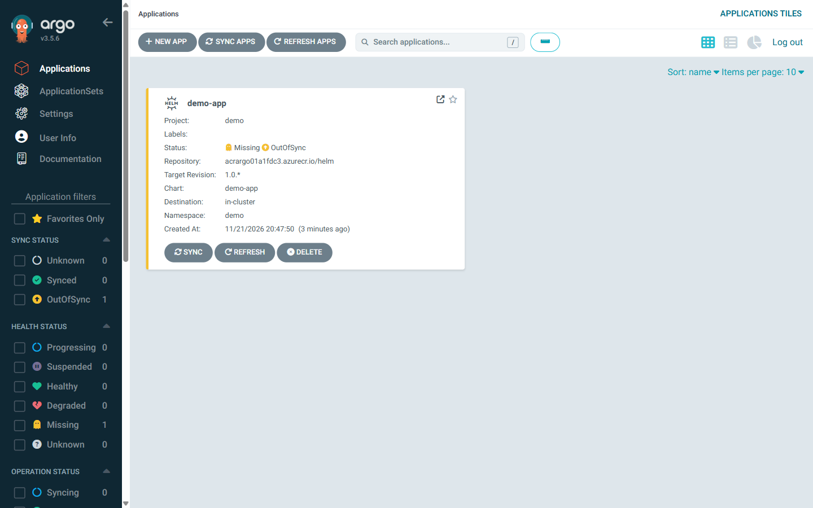
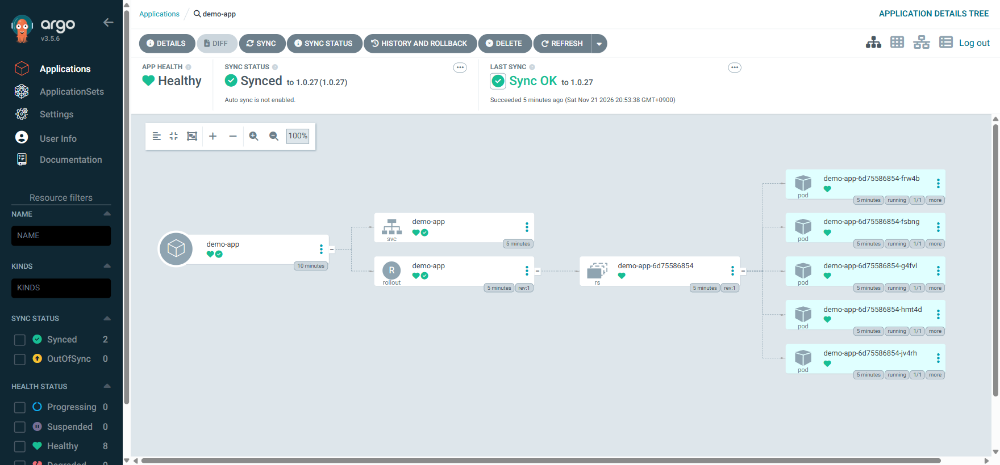
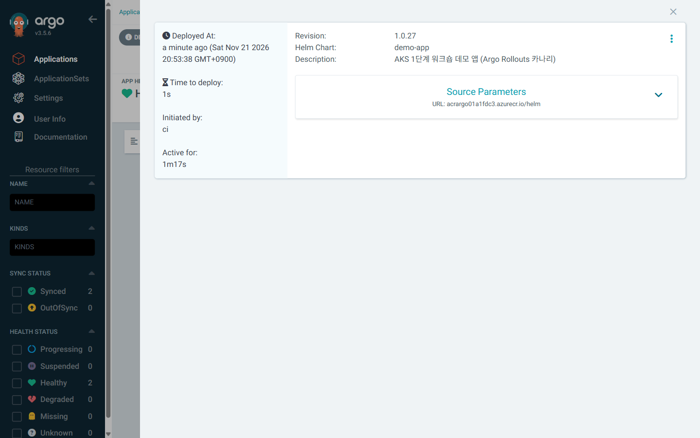
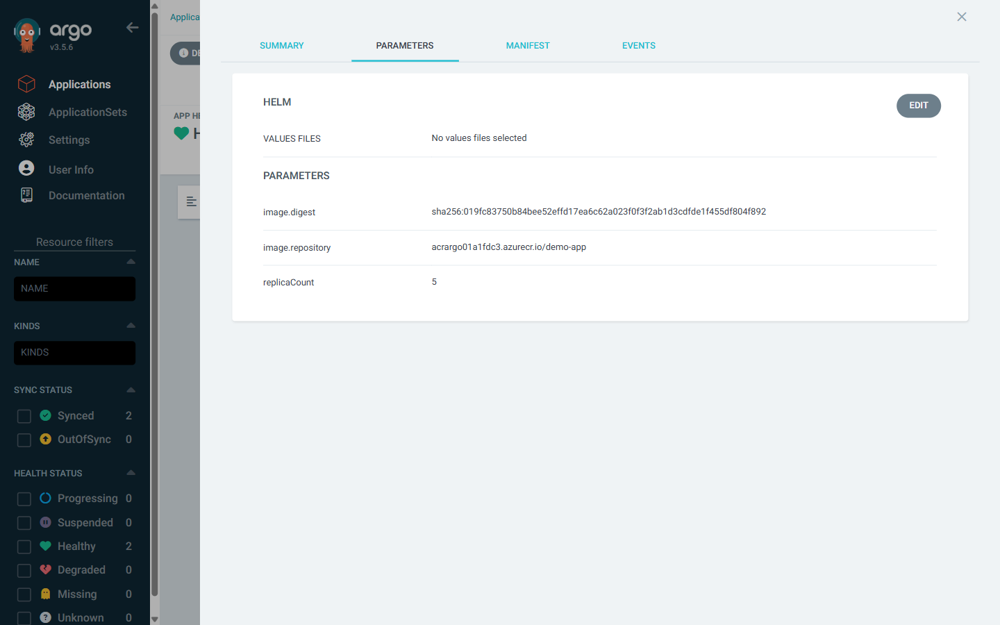

# 04. Argo CD UI로 첫 배포

**목표:** Argo CD UI에서 ACR 차트 저장소를 연결하고 Application을 만든 뒤, 파이프라인을 다시 실행해 **CI가 요청한 Sync**로 v1 Pod 다섯 개를 띄웁니다.

## 1. 배포 허용 범위(AppProject) 적용

👁️ **설명** — `AppProject`는 *어느 소스에서 어느 네임스페이스로 무엇을 배포해도 되는지* 정하는 울타리입니다. [`bootstrap/project.yaml`](../bootstrap/project.yaml)은 소스를 **실습 ACR의 `helm/` 경로**로, 대상을 `demo` 네임스페이스로, 리소스 종류를 `Rollout`과 `Service`, 그리고 Rollout이 만드는 `ReplicaSet`·`Pod`로 제한합니다. 뒤의 두 종류를 빼면 배포는 되지만 **Argo CD UI 트리에서 ReplicaSet과 Pod가 보이지 않습니다.** Argo CD는 프로젝트가 허용하지 않은 종류를 트리에 표시하지 않기 때문입니다. 03의 `ci` 계정 권한도 이 프로젝트 이름(`demo`)을 기준으로 선언돼 있습니다.

🟢 **실행 · 참가자 PC / PowerShell**

```powershell
(Get-Content .\bootstrap\project.yaml -Raw).Replace('ACR_LOGIN_SERVER',$loginServer) | kubectl apply -f -
kubectl get appproject demo -n argocd -o jsonpath='{.spec.sourceRepos}{"\n"}'
```

📋 **확인** — 출력이 `["<ACR 로그인 서버>/helm"]`입니다.

## 2. UI에서 ACR 차트 저장소 연결

👁️ **설명** — ACR은 Helm 차트를 **OCI 형식**으로 보관합니다. Argo CD에는 비밀번호 대신 **Azure 워크로드 ID**로 접속하도록 등록합니다. 그러면 02에서 만든 관리 ID(`AcrPull`)의 토큰을 `argocd-repo-server`가 그때그때 받아 씁니다. 저장소 등록 정보에 비밀 값이 남지 않습니다.

🟢 **실행 · 브라우저 / Argo CD UI → Settings → Repositories → + CONNECT REPO**

| 항목 | 값 |
|---|---|
| 연결 방식 | 상단 **VIA SSH**를 눌러 **VIA HTTP/HTTPS**로 바꿉니다. |
| Type | `helm` |
| Name | `acr-helm` |
| Project | 비워 둡니다. |
| Repository URL | `<ACR 로그인 서버>/helm` — **`https://`나 `oci://`를 붙이지 않습니다.** 예: `acrargo1a2b3c4d.azurecr.io/helm` |
| Username / Password | 비워 둡니다. |
| Enable OCI | 체크 |
| Use Azure Workload Identity | 체크 |



*그림: 입력 화면 위쪽입니다. 연결 방식을 VIA HTTP/HTTPS로 바꾸고, Repository URL에는 스킴 없이 `<ACR 로그인 서버>/helm`만 넣습니다.*



*그림: 아래로 스크롤해 Username·Password는 비워 두고, **Enable OCI**와 **Use Azure Workload Identity**를 체크합니다.*

**CONNECT**를 누릅니다.

📋 **확인** — 목록에서 `acr-helm`의 **CONNECTION STATUS**가 `Successful`입니다.



*그림: 연결이 끝나면 몇 초 안에 `Successful`로 바뀝니다.*

> **UI 등록이 안 될 때의 대체 경로:** 같은 내용을 [`bootstrap/repository.yaml`](../bootstrap/repository.yaml)로 적용할 수 있습니다. 이 파일에도 비밀 값은 없습니다.
>
> ```powershell
> (Get-Content .\bootstrap\repository.yaml -Raw).Replace('ACR_LOGIN_SERVER',$loginServer) | kubectl apply -f -
> ```

## 3. UI에서 Application 만들기

👁️ **설명** — `Application`은 *어느 차트를 어느 클러스터·네임스페이스에 배포할지* 적은 명세입니다. 이번 단계에서는 **자동 Sync를 끕니다(Manual).** 그래서 Application을 만들어도 바로 배포되지 않고, 이후 배포는 CI의 Sync 요청이나 UI의 SYNC 버튼으로만 일어납니다.

🟢 **실행 · 브라우저 / Argo CD UI → Applications → + NEW APP**

⚠️ **입력 순서가 중요합니다.** SOURCE의 Repository URL을 입력하기 **전에** 오른쪽 **GIT ▾**을 눌러 **HELM**으로 바꾸세요. URL을 먼저 고르면 화면이 Git용(Revision·Path) 입력란으로 남아 차트 이름을 넣을 수 없습니다. 그렇게 됐다면 **CANCEL** 후 다시 시작합니다.

| 구역 | 항목 | 값 |
|---|---|---|
| GENERAL | Application Name | `demo-app` |
| GENERAL | Project Name | `demo` |
| GENERAL | SYNC POLICY | `Manual` (기본값 그대로) |
| GENERAL | SYNC OPTIONS | **AUTO-CREATE NAMESPACE** 체크 |
| SOURCE | 저장소 종류 | **GIT ▾ → HELM** (URL 입력 전에) |
| SOURCE | Repository URL | 2절에서 연결한 `<ACR 로그인 서버>/helm` |
| SOURCE | Chart | `demo-app` — 목록이 비어 있으면 직접 입력합니다. |
| SOURCE | Chart 오른쪽 버전 칸 | `1.0.*` |
| DESTINATION | Cluster URL | `https://kubernetes.default.svc` |
| DESTINATION | Namespace | `demo` |



*그림: GENERAL 구역입니다. SYNC POLICY는 `Manual` 그대로 두고, AUTO-CREATE NAMESPACE만 체크합니다.*



*그림: SOURCE 오른쪽이 **HELM ✓**이면 Chart와 버전 칸이 나타납니다. GIT으로 남아 있으면 Path 칸이 보입니다.*

차트를 제대로 읽으면 화면 아래 **Helm → PARAMETERS**에 `image.digest`, `image.repository`, `replicaCount`가 채워집니다. `image.digest`가 03에서 기록한 digest와 같은지 보세요. 관리 ID로 ACR 차트를 읽었다는 증거입니다. 확인했으면 맨 위 **CREATE**를 누르고, 창이 닫힐 때까지 몇 초 기다립니다.



*그림: PARAMETERS 값은 ACR 차트의 `values.yaml`에서 읽어 온 것입니다. `image.digest`가 03 빌드 로그의 digest와 같아야 합니다.*

👁️ **왜 `1.0.*`인가요?** — 처음 만들 때 ACR에 있는 가장 높은 `1.0.x` 차트를 고르라는 뜻입니다. 이후에는 CI가 빌드마다 `argocd app set --revision 1.0.<빌드 ID>`로 **정확한 버전**을 지정합니다. OCI 저장소라 Chart 목록이 비어 보이는 것은 정상입니다.

📋 **확인 · 입력한 내용 대조** — 방금 만든 명세를 저장소의 [`bootstrap/application.yaml`](../bootstrap/application.yaml)과 비교합니다.

```powershell
kubectl get application demo-app -n argocd -o jsonpath='{.spec}{"\n"}'
Get-Content .\bootstrap\application.yaml
```

`chart`, `repoURL`, `targetRevision`, `destination`, `syncOptions`의 `CreateNamespace=true`가 같고, **`automated`가 없어야** 합니다. 화면의 `demo-app` 카드는 `OutOfSync`·`Missing`입니다. 아직 아무것도 배포하지 않았으니 정상입니다. 만든 직후에는 상태 아이콘이 `?`로 보일 수 있습니다. 몇 초 뒤 바뀝니다.



*그림: Application은 생겼지만 Manual이라 아직 배포되지 않았습니다. 다음 절에서 CI가 Sync를 요청합니다.*

> **UI 생성이 안 될 때의 대체 경로:**
>
> ```powershell
> (Get-Content .\bootstrap\application.yaml -Raw).Replace('ACR_LOGIN_SERVER',$loginServer) | kubectl apply -f -
> ```

## 4. 파이프라인 재실행으로 첫 배포

👁️ **설명** — 이제 Application이 있으므로 03에서 경고만 남겼던 `Deploy` Job이 실제로 Sync를 요청합니다. 이번 실행은 새 이미지와 새 차트 `1.0.<새 빌드 ID>`를 만들고, 그 버전을 Application에 지정한 뒤 Sync합니다. 처음 만드는 Rollout은 비교할 이전 버전이 없으므로 **카나리 정지 없이** 바로 5개를 띄웁니다.

🟢 **실행 · 브라우저 / Azure DevOps → Pipelines → demo-app 파이프라인 → Run pipeline**

실행이 끝나면 `Deploy` 로그 끝부분에서 아래와 같은 줄을 확인합니다. 경고는 없어야 합니다.

```text
Sync Status:        Synced to 1.0.<빌드 ID>
```

🟢 **실행 · 참가자 PC / PowerShell**

```powershell
kubectl argo rollouts status demo-app -n demo --timeout 5m
kubectl get rs -n demo -l app=demo-app
kubectl get application demo-app -n argocd -o jsonpath='{.status.sync.revision} {.status.sync.status} {.status.health.status}{"\n"}'
kubectl get application demo-app -n argocd -o jsonpath='{.status.history[-1:].initiatedBy.username}{"\n"}'
```

**예상 결과:** ReplicaSet의 `READY`가 5, 세 번째 명령은 `1.0.<빌드 ID> Synced Healthy`, 마지막 명령은 `ci`입니다. Sync를 누가 요청했는지가 Argo CD에 **`ci`**로 남는다는 뜻입니다.

🟢 **실행 · 브라우저 / Argo CD UI → Applications → demo-app**

1. 카드가 `Healthy`·`Synced`로 바뀌었습니다. 카드를 눌러 트리에서 `svc`, `rollout`, ReplicaSet, Pod 5개를 찾습니다. 상단 SYNC STATUS 아래의 `Auto sync is not enabled.`는 이 워크숍 설계대로 자동 Sync가 꺼져 있다는 뜻입니다.

   

   *그림: Rollout → ReplicaSet → Pod 5개. 05에서는 이 자리에 ReplicaSet이 두 개 생깁니다.*

2. 상단 **HISTORY AND ROLLBACK**에서 Revision `1.0.<빌드 ID>` 항목을 확인합니다. **Initiated by**가 `ci`입니다. 05에서 롤백할 때 이 목록을 씁니다.

   

   *그림: 배포마다 차트 버전, 요청자, 배포 시각이 한 줄씩 쌓입니다.*

3. 상단 **DETAILS → PARAMETERS** 탭의 `image.digest`가 이번 실행 **Push image and Helm chart to ACR** 로그의 digest와 같은지 확인합니다.

   

   *그림: 3절 NEW APP 화면에서 본 digest와 다릅니다. CI가 이번 빌드의 차트 버전을 지정했기 때문입니다.*

📋 **확인 · 세 값 연결하기**

```powershell
kubectl get rollout demo-app -n demo -o jsonpath='{.spec.template.spec.containers[0].image}{"\n"}'
```

`@sha256:…` 부분은 이번 실행의 **이미지 digest**, 앞 절의 `status.sync.revision`은 **차트 버전**과 같아야 합니다. `Synced`는 명세가 차트와 일치한다는 뜻이지 Pod가 응답한다는 뜻은 아닙니다. ReplicaSet의 Ready 수까지 확인하세요.

**트러블슈팅**

| 증상 | 원인과 조치 |
|---|---|
| CONNECT REPO가 `Failed` | URL에 `https://`·`oci://`를 붙였는지, **Enable OCI**와 **Use Azure Workload Identity**를 모두 체크했는지, 02의 두 client ID가 같은지 확인합니다. |
| NEW APP에 Chart 칸 대신 Path 칸이 보임 | URL을 HELM 선택보다 먼저 입력했습니다. CANCEL 후 HELM을 먼저 고릅니다. |
| CREATE 시 `Unable to generate manifests` | 저장소 연결 상태와 버전 칸(`1.0.*`)을 확인합니다. CREATE 직후 창을 닫지 말고 기다립니다. |
| 재실행했는데 `Deploy`가 여전히 "아직 없음" 경고 | Application 이름이 `demo-app`, 프로젝트가 `demo`인지 확인합니다. 다른 이름이면 `ci`가 볼 수 없습니다. |
| Pod가 `ImagePullBackOff` | 차트 문제가 아닙니다. Rollout의 이미지 digest가 ACR에 있는지, kubelet의 AcrPull을 확인합니다. |
| 트리에 `svc`와 `rollout`만 있고 ReplicaSet·Pod가 없음 | AppProject에 `ReplicaSet`·`Pod` 허용이 빠졌습니다. 1절 명령으로 최신 `project.yaml`을 다시 적용하고 화면을 새로 고칩니다. |

📋 **완료 체크**

- [ ] UI로 저장소를 연결하고 Application을 만들었으며, 명세에 `automated`가 없습니다.
- [ ] 파이프라인 재실행 후 v1 Pod 5개가 Ready이고, History의 Sync 요청자가 `ci`입니다.

[← 이전](03-pipeline.md) · [목차](../README.md) · [다음: 카나리 →](05-canary.md)
