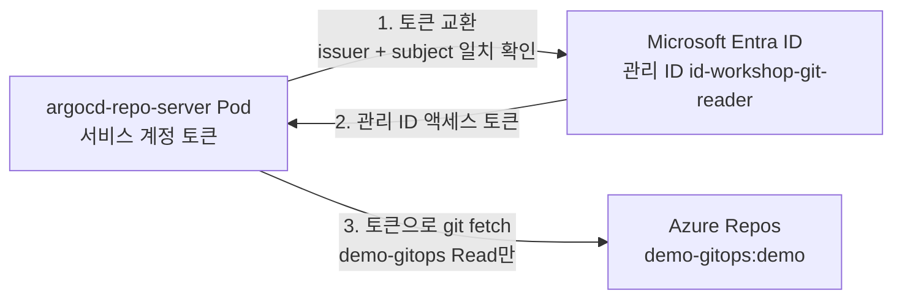
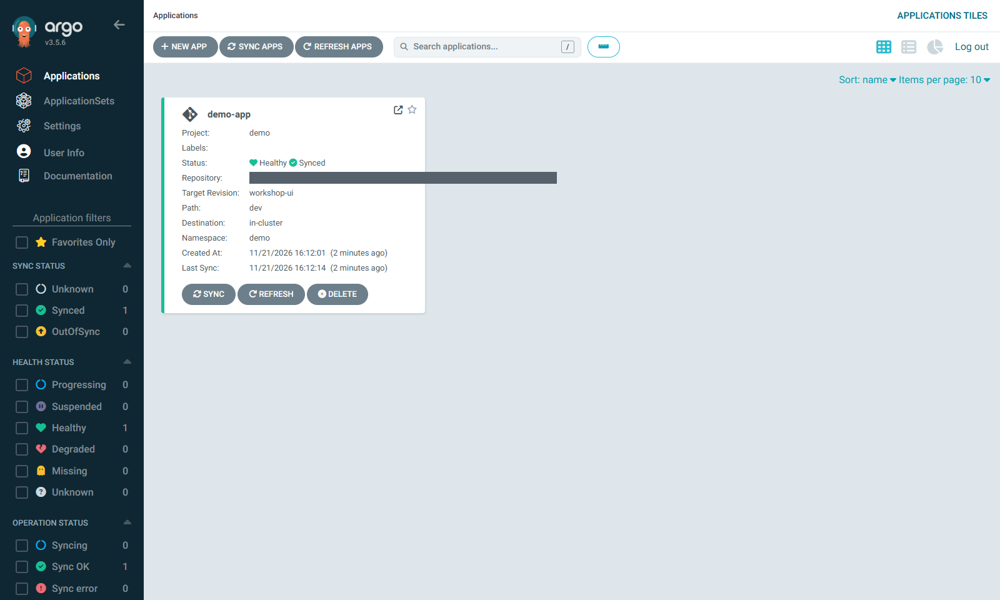
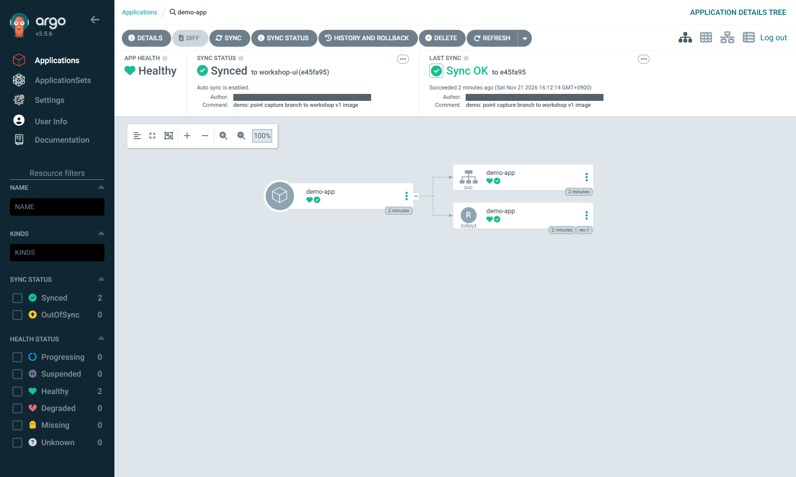

# 04. GitOps 저장소 연결과 첫 배포

**목표:** Argo CD가 비공개 `demo-gitops:demo`를 읽고 v1 Pod 다섯 개를 띄우도록 합니다. CI의 쓰기 ID와 Argo CD의 읽기 ID는 분리합니다.

## 1. Git 읽기용 관리 ID 만들기

👁️ **설명** — 비공개 Azure Repos는 익명 clone을 허용하지 않습니다. 이 실습은 PAT나 암호 대신 **사용자 할당 관리 ID**로 저장소를 읽습니다. Argo CD에서 Git을 읽는 구성 요소는 `argocd-repo-server`입니다. 이 Pod의 Kubernetes 서비스 계정 토큰을 Microsoft Entra ID가 신뢰하도록 **페더레이션**하면, Pod는 관리 ID의 토큰을 받아 Azure Repos에 접근합니다. 장기 비밀은 클러스터나 Git 어디에도 저장되지 않습니다.



페더레이션 자격 증명의 `issuer`는 **어느 클러스터인지**, `subject`는 **그 안의 어느 서비스 계정인지** 제한합니다. 따라서 다른 클러스터나 같은 클러스터의 다른 Pod는 이 관리 ID를 쓸 수 없습니다.

🟢 **실행 · 참가자 PC / PowerShell**, 이어서 **브라우저 / Azure DevOps**

```powershell
az aks update -g $rg -n $aks --enable-oidc-issuer --enable-workload-identity
$reader = az identity create -g $rg -n id-workshop-git-reader | ConvertFrom-Json
$issuer = az aks show -g $rg -n $aks --query oidcIssuerProfile.issuerUrl -o tsv
az identity federated-credential create -g $rg --identity-name id-workshop-git-reader -n argocd-repo-server --issuer $issuer --subject system:serviceaccount:argocd:argocd-repo-server --audiences api://AzureADTokenExchange
```

첫 줄은 AKS가 서비스 계정 토큰을 발급하는 OIDC 발급자를 공개하고, Pod에 Azure 토큰 정보를 주입하는 워크로드 ID 웹후크를 켭니다. 이미 켜져 있으면 그대로 진행됩니다.

Azure DevOps **Organization settings → Users → Add users**에서 `id-workshop-git-reader`를 검색해 추가합니다. 이름이 같은 항목이 여럿이면 `$reader.principalId`와 대조합니다. 권한은 아래 세 가지만 줍니다.

| 항목 | 값 | 이유 |
|---|---|---|
| 액세스 수준 | **Basic** | Stakeholder는 비공개 Repos의 코드를 읽을 수 없습니다. |
| 실습 프로젝트 | **View project-level information**만 Allow | 프로젝트를 찾을 수 있게 합니다. 프로젝트 그룹(Contributors·Readers)에는 추가하지 않습니다. |
| `demo-gitops` 저장소 | **Read**만 Allow | `demo-app` 소스와 다른 저장소는 읽지 못하게 합니다. |

조직 정책상 관리 ID 등록이 제한되면 관리자에게 요청하세요.

📋 **확인** — Azure에서 관리 ID를 만든 것만으로 Azure Repos 권한이 생기지는 않습니다. 조직에 추가한 ID가 `$reader.principalId`와 같은지, Read 권한을 준 저장소가 `demo-gitops` 하나뿐인지 확인하세요.

## 2. Argo CD 확장 설정으로 관리 ID 연결

👁️ **설명** — `argocd` 네임스페이스의 리소스는 AKS 확장이 관리합니다. 서비스 계정이나 Deployment를 `kubectl annotate/patch`로 직접 고치면, 확장이 업데이트될 때 원래대로 돌아갈 수 있습니다. 그래서 **확장 구성 값**으로 관리 ID를 지정합니다. 그러면 확장이 서비스 계정 주석, Pod 레이블, 환경 변수를 알아서 관리합니다.

🟢 **실행 · 같은 PowerShell**

```powershell
az k8s-extension update -g $rg --cluster-name $aks --cluster-type managedClusters -n argocd --config azure.workloadIdentity.enabled=true --config "azure.workloadIdentity.clientId=$($reader.clientId)" --yes
az k8s-extension show -g $rg --cluster-name $aks --cluster-type managedClusters -n argocd --query configurationSettings
kubectl rollout status deployment/argocd-repo-server -n argocd --timeout=5m
kubectl get sa argocd-repo-server -n argocd -o jsonpath='{.metadata.annotations.azure\.workload\.identity/client-id}{"\n"}'
kubectl get deployment argocd-repo-server -n argocd -o jsonpath='{.spec.template.metadata.labels.azure\.workload\.identity/use}{"\n"}'
```

📋 **확인** — 아래 세 가지를 확인합니다.

- `configurationSettings`에 02에서 넣은 `redis-ha.enabled`, `server.service.type`이 그대로 있고, `azure.workloadIdentity.*` 두 값이 추가됐습니다. `update`는 기존 설정을 지우지 않고 값을 덧붙입니다.
- 서비스 계정 주석의 값이 `$reader.clientId`와 같습니다.
- Deployment 레이블 값이 `true`입니다.

확장은 Git을 읽는 `argocd-repo-server`에만 이 client ID를 연결합니다. 다른 Argo CD 구성 요소에는 이 관리 ID가 붙지 않습니다.

이제 저장소를 등록합니다. `$repo`는 03에서 복사한 `demo-gitops` HTTPS 주소입니다.

```powershell
@{apiVersion='v1';kind='Secret';metadata=@{name='demo-gitops';namespace='argocd';labels=@{'argocd.argoproj.io/secret-type'='repository'}};stringData=@{type='git';project='demo';url=$repo;useAzureWorkloadIdentity='true'}} |
  ConvertTo-Json -Depth 6 | kubectl apply -f -
```

이 Secret에는 PAT나 암호가 **없습니다**. `useAzureWorkloadIdentity='true'`는 repo-server가 접속할 때 위 관리 ID로 토큰을 받아 쓰라는 표시입니다.

⚠️ **주의** — 02의 Bicep에는 `azure.workloadIdentity.*` 값이 없습니다. 같은 템플릿을 **다시 배포하면 두 값이 삭제**되고 Git 읽기가 실패합니다(`what-if`에서 `Delete`로 표시됨). 템플릿을 다시 배포했다면 이 절의 `az k8s-extension update`를 다시 실행하세요. 운영 환경에서는 이 두 값을 Bicep의 `configurationSettings`에 함께 선언해 관리합니다. 자세한 내용은 [Argo CD 확장과 워크로드 ID](https://learn.microsoft.com/azure/azure-arc/kubernetes/tutorial-use-gitops-argocd#create-gitops-argo-cd-extension-with-workload-identity)를 참고하세요.

## 3. Application 생성 및 관찰

👁️ **설명** — `AppProject`는 *어느 저장소에서 어느 네임스페이스로 배포해도 되는지* 정하고, `Application`은 *그 저장소의 어떤 브랜치와 경로를 따라갈지* 지정합니다. `demo` 네임스페이스에 앱 YAML을 직접 적용하지 마세요. Git에서 읽어 생성하는 것이 이번 단계의 관찰 대상입니다.

🟢 **실행 · 같은 PowerShell**

```powershell
foreach ($f in 'project','application') {
  (Get-Content ".\bootstrap\$f.yaml" -Raw).Replace('GITOPS_REPO_URL',$repo) | kubectl apply -f -
  if ($LASTEXITCODE -ne 0) { throw "$f 등록 실패" }
}
kubectl wait -n demo --for=create rollout/demo-app --timeout=5m
kubectl argo rollouts status demo-app -n demo --timeout 5m
kubectl get application demo-app -n argocd
kubectl get rs -n demo -l app=demo-app
```

**예상 결과:** `Synced`이며 v1 ReplicaSet의 `READY`가 5입니다. 최초 배포는 비교할 이전 버전이 없어 카나리 정지를 하지 않습니다.

### 브라우저에서 같은 배포 확인하기

1. 같은 실습 kubeconfig를 쓰는 PowerShell 창에서 아래 명령을 실행한 채 둡니다. 서비스는 `ClusterIP`로 유지되며 참가자 PC의 루프백에서만 접속할 수 있습니다.

   ```powershell
   kubectl port-forward -n argocd --address 127.0.0.1 svc/argocd-server 19443:443
   ```

2. 브라우저에서 `https://127.0.0.1:19443`을 엽니다. 인증서 경고가 있다면 **방금 포워딩한 로컬 주소**인지 먼저 확인합니다. 조직에서 발급한 계정이 있으면 그 계정을 사용하세요. 이 워크숍처럼 방금 생성한 전용 클러스터의 최초 관리자라면, 다른 PowerShell 창에서 **같은 `$env:KUBECONFIG`**를 지정하고 다음 명령으로 초기 암호를 클립보드에 복사합니다. 사용자 이름은 `admin`입니다. 로그인 후 클립보드를 비우고 초기 암호를 변경하세요. 공유 PC나 녹화 중인 터미널에서는 초기 암호를 출력하지 않습니다.

   ```powershell
   $encoded = kubectl get secret argocd-initial-admin-secret -n argocd -o jsonpath='{.data.password}'
   if ($LASTEXITCODE -ne 0 -or !$encoded) { throw '초기 관리자 Secret을 사용할 수 없습니다.' }
   Set-Clipboard -Value ([Text.Encoding]::UTF8.GetString([Convert]::FromBase64String($encoded)))
   Remove-Variable encoded
   ```

   브라우저에서 붙여넣은 **뒤에** `Set-Clipboard -Value ''`를 별도로 실행합니다.

3. **Applications**에서 `demo-app` 카드를 찾습니다. **Project: demo**, **Path: dev**, **Namespace: demo**를 확인합니다. 위에서 Application을 이미 등록했으므로 **NEW APP**을 다시 누르지 않습니다.

   

4. 카드의 **demo-app** 이름을 클릭합니다. **SYNC STATUS** 옆의 짧은 SHA를 Azure Repos의 **GitOps 커밋**과 비교하고, 아래 트리에서 `svc`와 `rollout`을 찾습니다. `LAST SYNC: Sync OK`와 `APP HEALTH: Healthy`는 서로 다른 확인 항목입니다.

   

   *04·05 그림은 AKS의 `Microsoft.ArgoCD` 확장(v3.5.6)에 Playwright로 접속해 촬영한 실제 화면입니다. 기존 `demo` 브랜치를 건드리지 않도록 촬영에만 `workshop-ui` 브랜치와 별도 ACR 빌드를 사용했습니다. 참가자는 교재의 `demo` 브랜치를 그대로 사용하며 SHA·시간은 달라집니다. 비공개 주소와 개인 작성자 정보는 가렸습니다.*

📋 **확인 · 어느 커밋을 배포했나요?**

```powershell
kubectl get application demo-app -n argocd -o jsonpath='{.status.sync.revision}'
kubectl get rollout demo-app -n demo -o jsonpath='{.spec.template.spec.containers[0].image}'
```

첫 출력은 **03의 GitOps 커밋 SHA**, 두 번째 출력의 `@sha256:…` 부분은 **03의 ACR digest**와 같아야 합니다. `Synced`는 명세가 Git과 일치한다는 뜻이지 Pod가 요청에 응답한다는 뜻은 아닙니다. 위 ReplicaSet의 Ready 수까지 확인하세요.

**트러블슈팅:** `ComparisonError`는 다음 순서로 확인합니다: Git URL → `demo-gitops` Read 권한 → 확장의 `azure.workloadIdentity.clientId` → 페더레이션 subject(`system:serviceaccount:argocd:argocd-repo-server`). `ImagePullBackOff`는 Git 문제가 아닙니다. ACR digest와 kubelet의 AcrPull부터 확인합니다.

**완료 체크:** Git 커밋이 동기화됐고 v1 Pod 5개가 Ready입니다.

[← 이전](03-pipeline.md) · [목차](../README.md) · [다음: 카나리 →](05-canary.md)
