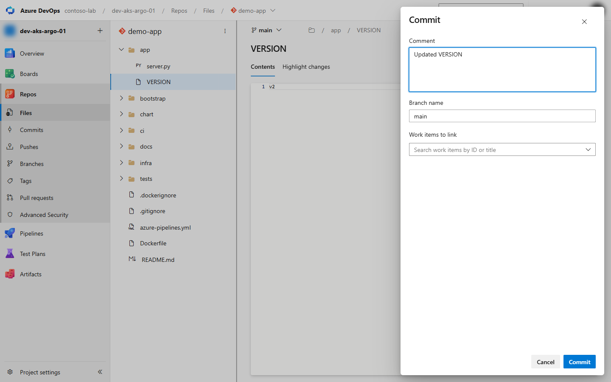
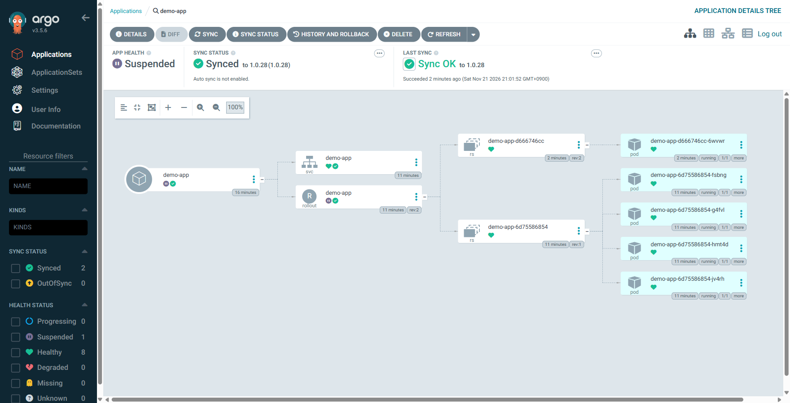
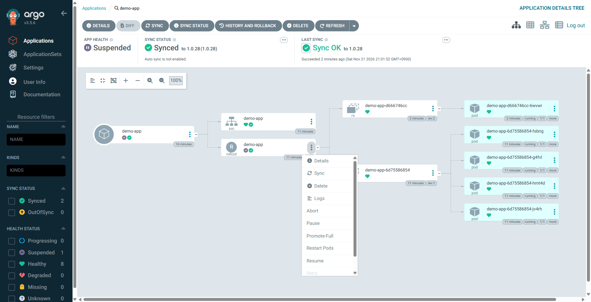
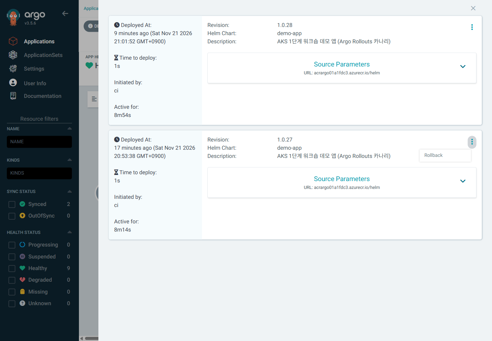
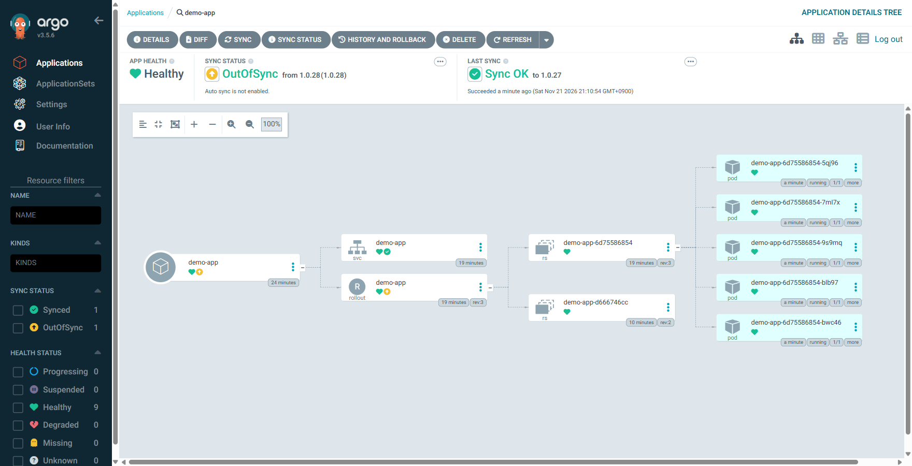

# 05. 카나리 배포와 롤백

**목표:** v2를 배포해 카나리 상태에서 멈춘 것을 확인하고, UI에서 승격(Resume)합니다. 이어서 Argo CD History로 긴급 롤백한 뒤, 코드를 되돌려 정상 상태로 복구합니다.

## 1. v2 릴리스

👁️ **설명** — [Rollout 템플릿](../chart/demo-app/templates/rollout.yaml)은 Pod 5개를 목표로 하며 단계가 `setWeight: 20` → `pause: {}` → `setWeight: 100`입니다. 정지 시간을 지정하지 않았기 때문에 v2 하나가 뜬 상태에서 **사람이 승격할 때까지 멈춥니다.** 이번 실습에서 `Suspended`(정지)는 장애가 아니라 의도한 상태입니다.

🟢 **실행 · 브라우저 / Azure DevOps → Repos → demo-app → Files**

1. `app/VERSION`을 열고 **Edit**를 누릅니다.
2. 값 `v1`을 `v2`로 바꾸고 오른쪽 위 **Commit**을 누릅니다. 창이 열리면 **Branch name**이 `main`인지 확인하고 아래쪽 **Commit**을 누릅니다.

   

   *그림: 편집기 줄 1이 `v2`입니다. Comment는 기본값 `Updated VERSION` 그대로 둬도 됩니다.*

3. **Pipelines**에서 이 커밋으로 **자동 실행 한 건**이 시작되는지 봅니다. 1~2분 걸릴 수 있습니다. 같은 커밋으로 수동 실행을 추가하지 마세요.

파이프라인의 `Deploy` Job은 Sync를 요청하고 **Sync가 끝날 때까지만** 기다립니다. 카나리 승격까지 기다리지 않으므로 Rollout이 정지 상태여도 파이프라인은 성공으로 끝납니다.

🟢 **실행 · 참가자 PC / PowerShell** — 파이프라인이 끝나면 관찰합니다.

```powershell
kubectl argo rollouts get rollout demo-app -n demo
kubectl get rs -n demo -l app=demo-app
```

첫 명령의 `Status`는 `॥ Paused`입니다. 60초 뒤에 `kubectl get rs -n demo -l app=demo-app`을 한 번 더 실행합니다. 두 번 모두 **v1 Ready 4개, v2 Ready 1개**여야 합니다. 이 숫자는 Pod 비율이며 실제 요청이 정확히 20%씩 나뉜다는 뜻은 아닙니다.

📋 **확인 · 예상 출력 예시** — 이름 뒤의 해시는 환경마다 다릅니다. 이름 순서가 아니라 **READY**를 보세요.

```text
NAME                   DESIRED   CURRENT   READY
demo-app-<기존 해시>          4         4       4
demo-app-<신규 해시>          1         1       1
```

### Argo CD 화면에서 정지와 실패 구분하기

Argo CD UI에서 **Applications → demo-app**을 엽니다. **SYNC STATUS**는 `Synced`이고 **APP HEALTH**는 `Suspended`입니다. 트리의 `rollout` 노드에도 정지 표시가 붙고, ReplicaSet 두 개가 각각 Pod 4개와 1개를 거느립니다.



*그림: 위쪽 `rs`(rev:2)가 v2 카나리 1개, 아래쪽 `rs`(rev:1)가 v1 4개입니다. Sync는 `Synced to 1.0.<v2 빌드 ID>`로 이미 끝났습니다.*

새 차트는 이미 클러스터에 반영됐고 Rollouts가 사람의 승격을 기다리는 상태입니다. **SYNC를 다시 누르는 것은 승격이 아닙니다.**

## 2. 실제 응답 비교

👁️ **설명** — Service를 두 번 호출하면 우연히 같은 버전만 만날 수 있습니다. 아래 명령은 각 ReplicaSet에서 Pod를 하나씩 골라 그 Pod 안에서 `/version`을 호출합니다. 그래서 두 응답을 코드 변경 전후와 직접 연결할 수 있습니다.

🟢 **실행 · 참가자 PC / PowerShell**

```powershell
$sets = (kubectl get rs -n demo -l app=demo-app -o json | ConvertFrom-Json).items
foreach ($rs in $sets | Where-Object { $_.status.readyReplicas -gt 0 }) {
  $hash = $rs.metadata.labels.'rollouts-pod-template-hash'
  $pod = kubectl get pods -n demo -l "rollouts-pod-template-hash=$hash" -o jsonpath='{.items[0].metadata.name}'
  kubectl exec -n demo $pod -- python -c "import urllib.request; print(urllib.request.urlopen('http://localhost:8080/version').read().decode())"
}
```

**예상 결과:** 한 응답은 `v1`, 다른 응답은 `v2`이고 `commit`도 서로 다릅니다.

## 3. UI에서 승격(Resume)

👁️ **설명** — 승격은 멈춘 카나리를 **계속 진행**시키는 동작입니다. Argo CD UI에서 Rollout 리소스에 대해 바로 실행할 수 있습니다.

🟢 **실행 · 브라우저 / Argo CD UI → Applications → demo-app**

1. 트리에서 `rollout` 노드 오른쪽의 **⋮**를 누릅니다.
2. **Resume**을 선택하고 `Perform resume action?` 확인 창에서 **OK**를 누릅니다.



*그림: 아래쪽 Rollouts 전용 동작 중 **Resume**을 고릅니다. **Promote-Full**은 남은 단계를 건너뛰고 바로 100%로 보내는 동작이라 이번 실습에서는 쓰지 않습니다.*

🟢 **실행 · 참가자 PC / PowerShell**

```powershell
kubectl argo rollouts status demo-app -n demo --timeout 5m
kubectl get rs -n demo -l app=demo-app
```

**예상 결과:** `Healthy`, 그리고 **v2 Ready 5개**·v1 0개입니다. UI의 APP HEALTH도 `Healthy`로 바뀝니다.

> **CLI 대안:** 같은 승격을 `kubectl argo rollouts promote demo-app -n demo`로 할 수 있습니다. 실습에서는 팀이 UI에 익숙해지도록 Resume 메뉴를 씁니다.

## 4. History로 긴급 롤백

👁️ **설명** — v2에 문제가 있다고 가정합니다. 코드를 고쳐 새 빌드를 기다리기 전에, Argo CD가 기억하는 **이전 차트 버전으로 즉시 되돌릴 수 있습니다.** Rollout의 `rollbackWindow`(최근 3개 버전) 덕분에 이전 버전으로 돌아갈 때는 카나리 정지 없이 바로 5개가 교체됩니다.

🟢 **실행 · 브라우저 / Argo CD UI → Applications → demo-app → HISTORY AND ROLLBACK**

1. 목록에서 v1이었던 차트 버전(04에서 확인한 `1.0.<빌드 ID>`) 항목을 찾습니다. 최신 배포가 맨 위에 있고, 항목마다 배포 시각, 차트 버전(Revision), 요청자(Initiated by)가 보입니다.
2. 그 항목 오른쪽 위의 **⋮ → Rollback**을 누르고 `Rollback application` 확인 창에서 **OK**를 누릅니다.



*그림: 두 항목의 Description은 차트 설명이라 같습니다. Revision 값으로 구분합니다.*

🟢 **실행 · 참가자 PC / PowerShell**

```powershell
kubectl get rs -n demo -l app=demo-app
kubectl get application demo-app -n argocd -o jsonpath='{.status.sync.status} {.status.history[-1:].initiatedBy.username}{"\n"}'
```

**예상 결과:** 수십 초 안에 **v1 Ready 5개**·v2 0개, 두 번째 명령은 `OutOfSync admin`입니다.



*그림: 클러스터는 `1.0.27`(LAST SYNC)로 돌아갔지만 Application 명세는 여전히 `1.0.28`을 가리키므로 `OutOfSync`입니다.*

⚠️ **롤백 뒤 상태를 이해하세요.**

| 관찰 | 의미 |
|---|---|
| `OutOfSync` | Application 명세는 여전히 v2 차트 버전을 가리킵니다. 클러스터만 이전 버전으로 돌아간 상태입니다. |
| History 요청자 `admin` | 누가 긴급 조치를 했는지 남습니다. CI 배포는 `ci`로 남으므로 구분됩니다. |
| 다음 CI 실행 | 새 차트 버전을 지정해 Sync하므로 롤백한 상태를 덮어씁니다. |

즉 롤백은 **시간을 버는 긴급 조치**입니다. 코드가 그대로 v2이면 다음 빌드에서 v2가 다시 나갑니다. 그래서 다음 절에서 원인(코드)을 되돌립니다.

## 5. 코드를 되돌려 정상화

🟢 **실행 · 브라우저 / Azure DevOps → Repos → demo-app → Files**

`app/VERSION`을 `v2`에서 `v1`로 바꿔 **Commit**합니다. 자동 실행 한 건이 끝날 때까지 기다립니다.

👁️ **설명** — 내용은 v1이지만 **새 커밋으로 새로 빌드한 이미지**이므로 digest가 달라집니다. Rollouts에게는 새 버전이므로 다시 카나리로 멈춥니다. 1절과 같이 4:1을 확인하고, 3절과 같이 UI에서 **Resume**합니다.

🟢 **실행 · 참가자 PC / PowerShell**

```powershell
kubectl argo rollouts status demo-app -n demo --timeout 5m
kubectl get application demo-app -n argocd -o jsonpath='{.status.sync.revision} {.status.sync.status} {.status.health.status} {.status.history[-1:].initiatedBy.username}{"\n"}'
```

**예상 결과:** `1.0.<새 빌드 ID> Synced Healthy ci`입니다. 2절의 명령을 다시 실행하면 응답이 한 줄이고 `v1`, `commit`은 방금 만든 커밋입니다. 승격 직후 30초쯤은 이전 Pod가 종료 중이라 `kubectl get pods`에 더 많이 보일 수 있습니다.

**트러블슈팅**

| 증상 | 원인과 조치 |
|---|---|
| v2 커밋 후 파이프라인이 시작되지 않음 | 자동 실행은 1~2분 늦을 수 있습니다. 그래도 없으면 파이프라인의 트리거가 `main`인지 확인합니다. |
| 정지 없이 바로 v2 5개가 됨 | 이미 같은 이미지가 최근 3개 버전 안에 있으면 `rollbackWindow`로 즉시 교체됩니다. 새 커밋인지 확인합니다. |
| ⋮ 메뉴에 Resume이 없음 | `rollout` 노드가 아니라 ReplicaSet·Pod 노드의 메뉴를 열었습니다. 또는 이미 승격돼 정지 상태가 아닙니다. |
| 롤백 후 `Healthy`인데 `OutOfSync` | 정상입니다. 4절 표를 보세요. SYNC를 누르면 다시 v2로 갑니다. |
| `Synced`인데 응답이 예상과 다름 | `status.sync.revision`이 기대하는 차트 버전인지 먼저 비교합니다. |

📋 **완료 체크**

| 관찰 시점 | v1 Ready | v2 Ready | 함께 대조할 증거 |
|---|---:|---:|---|
| 카나리 정지 | 4 | 1 | 두 `/version` 응답의 서로 다른 commit, UI `Suspended` |
| UI Resume 후 | 0 | 5 | UI `Healthy`·`Synced` |
| History 롤백 후 | 5 | 0 | `OutOfSync`, History 요청자 `admin` |
| 코드 되돌림·Resume 후 | 5 | 0 | `Synced`, 요청자 `ci`, 새 commit의 `v1` 응답 |

## 6. 이 방식의 한계

👁️ **설명** — 이번 실습에서 팀은 Git 저장소를 하나만 다루면서 Argo CD의 화면, 카나리, History를 익혔습니다. 동시에 실습하면서 다음 한계도 보았습니다. 운영에 적용할 때는 오른쪽 열의 방법으로 보완할 수 있습니다.

| 관찰한 한계 | 보완 방법 |
|---|---|
| 어떤 버전이 배포돼야 하는지가 Argo CD 안(Application 명세)에만 있습니다. UI에서 바꾸면 Git에 흔적이 남지 않습니다. | values와 Application 정의를 **Git 설정 저장소**로 옮깁니다. |
| 배포 승인이 "파이프라인을 누가 실행했는가"에 묶여 있습니다. | 설정 저장소의 **PR 승인**이 곧 배포 승인이 됩니다. |
| 롤백하면 `OutOfSync`가 남고, 누군가 손으로 바꾼 것을 Argo CD가 되돌리지 않습니다. | **자동 Sync와 Self-Heal**로 Git과 클러스터를 항상 일치시킵니다. |
| 환경이 늘면 Application을 UI에서 하나씩 만들어야 합니다. | **ApplicationSet**으로 환경별 Application을 생성합니다. |

이 보완 방법들은 모두 배포 설정을 Git에 두는 GitOps 방식입니다. 팀이 PR 기반 작업에 익숙해졌을 때 검토해 보세요.

[← 이전](04-first-sync.md) · [목차](../README.md) · [다음: 정리 →](06-cleanup.md)
