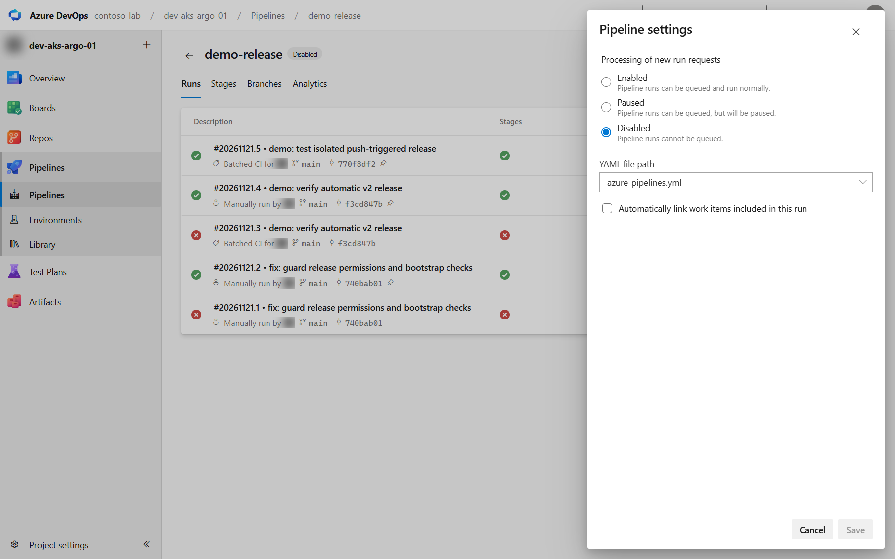

# 06. 정리와 과금 종료 확인

**목표:** 다음 빌드가 시작되지 않게 막은 뒤 실습 전용 자원과 권한을 회수합니다.

## 1. Argo CD와 Azure DevOps 정리

👁️ **설명** — Azure 리소스 그룹과 Azure DevOps 프로젝트는 관리 경계가 다릅니다. 그룹을 지워도 파이프라인은 남아서 다음 커밋에 반응하고, 그 실행은 사라진 서버에 Sync를 요청하다 실패합니다. 그래서 DevOps부터 정리합니다.

🟢 **실행 · 브라우저 / Argo CD UI**

왼쪽 아래 **Log out**을 선택합니다. 로그아웃만으로는 AKS 과금이 멈추지 않습니다. 03에서 만든 `ci` 토큰은 클러스터와 함께 삭제되므로 따로 폐기할 필요가 없습니다.

🟢 **실행 · 브라우저 / Azure DevOps**

1. **Pipelines → demo-app 파이프라인 → ⋯ → Settings**에서 **Processing of new run requests → Disabled**로 저장합니다. 진행 중인 실행이 없는지 확인합니다.



2. 저장 후 파이프라인 이름 옆에 **Disabled** 배지가 붙으면, 같은 **⋯** 메뉴에서 **Delete**로 파이프라인을 삭제합니다. 파이프라인 변수에 넣었던 `argocdToken`도 함께 사라집니다.
3. **Project settings → Repositories**에서 `demo-app` 저장소를 삭제합니다. 삭제한 저장소는 휴지통(**Deleted repositories**)에 남으므로 다시 쓸 일이 없으면 거기서도 영구 삭제합니다.

서비스 연결 `demo-acr-push`는 아직 지우지 않습니다. 연결이 쓰는 관리 ID에 페더레이션 자격 증명이 남아 있으면 Azure DevOps가 삭제를 거부합니다. 3절에서 그룹과 함께 관리 ID가 사라진 뒤 지웁니다.

## 2. 삭제 대상 확인

🟢 **실행 · 참가자 PC / PowerShell**

```powershell
az account show --query name -o tsv
az group show -n $rg --query "{name:name,tag:tags.workshop}" -o table
az resource list -g $rg -o table
$nodeGroup = az aks show -g $rg -n $aks --query nodeResourceGroup -o tsv
```

⚠️ **주의** — **실습에서 새로 만든 그룹이고 다른 리소스가 없을 때만** 진행하세요. 목록에는 AKS, ACR, 관리 ID 두 개(Argo CD용, CI 서비스 연결용)가 있어야 합니다. `$nodeGroup`은 AKS가 VM·디스크·**Argo CD 공인 IP**를 관리하는 별도 그룹입니다. AKS를 지우면 이 이름을 다시 조회할 수 없으므로 지금 기록합니다. 중간 실패로 AKS를 만들지 못했다면 기록한 전용 그룹만 확인하고, 공유 그룹이나 다른 노드 그룹을 대신 삭제하지 않습니다.

```powershell
az group delete -n $rg
az group exists -n $rg
if ($nodeGroup) { az group exists -n $nodeGroup }
az network public-ip list --query "[?ipAddress=='$argocdServer'].id" -o tsv
```

**예상 결과:** 두 그룹 모두 `false`이고, 마지막 명령은 아무것도 출력하지 않습니다. 즉 Argo CD 공인 IP도 사라졌습니다. 02에서 만든 임시 kubeconfig(`$env:KUBECONFIG`)도 더 필요 없으면 그 파일만 지웁니다.

**트러블슈팅:** 삭제 중 `true`이면 `az group show -n $rg --query properties.provisioningState`로 확인합니다. `Deleting`이면 아직 진행 중입니다.

## 3. 서비스 연결 삭제

🟢 **실행 · 브라우저 / Azure DevOps → Project settings → Service connections**

두 그룹이 모두 `false`가 된 뒤 이번 실습의 `demo-acr-push`를 선택하고 **⋮ → Delete**로 삭제합니다. 다른 팀이 쓰는 연결은 건드리지 않습니다.

⚠️ `Cannot delete this service connection while federated credentials ... exist` 오류가 나면 관리 ID가 아직 남아 있습니다. 2절의 그룹 삭제가 끝났는지 다시 확인합니다.

📋 **완료 체크**

- [ ] 파이프라인, `demo-acr-push` 서비스 연결, `demo-app` 저장소를 삭제했습니다.
- [ ] `az group exists`가 실습 그룹과 노드 그룹 모두 `false`이고, Argo CD 공인 IP가 조회되지 않습니다.
- [ ] 다시 시연할 때 남겨 쓸 교재와 삭제한 인프라를 구분할 수 있습니다.

[← 이전](05-canary.md) · [목차로 돌아가기](../README.md)
